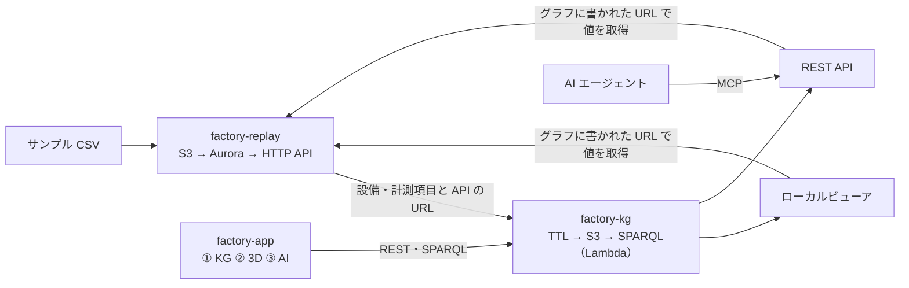

# IoT_lab

工場データを題材にした、低コストな AWS 検証キット。共有アカウントで使う前提で、リソース名はすべて利用者名（`<owner>`）付き。

| キット | 内容 | 方針 | 手順 |
|---|---|---|---|
| [factory-replay](factory-replay/) | 工場ラインのサンプル CSV を S3 に置くと Aurora に少しずつ反映され、HTTP API で取得・リセットできる | [実現方針](factory-replay/docs/実現方針.md) | [作業手順](factory-replay/docs/作業手順.md) |
| [factory-kg](factory-kg/) | replay の工場データを標準オントロジー（SOSA/SSN・SAREF4INMA・QUDT・DCAT/Hydra・SKOS）でナレッジグラフにし、各計測項目から replay の API を参照する。SPARQL・ローカルビューア・REST API（F/E アプリ向け）・MCP（AI エージェント向け）で使える | [実現方針](factory-kg/docs/実現方針.md) | [作業手順](factory-kg/docs/作業手順.md) |
| [factory-app](factory-app/) | 3 つの画面を持つローカルアプリ（TypeScript）: ① ナレッジグラフ ② データ連動の 3D 工場 ③ MCP を使う AI エージェント（Bedrock・費用の上限つき、作成中）。AWS なしのデモモードあり | [実現方針](factory-app/docs/実現方針.md) | [作業手順](factory-app/docs/作業手順.md) |

## 使う順番

1. factory-replay の環境を作り、CSV を流す（`factory-replay/docs/作業手順.md` の 0〜4 章）
2. factory-kg でグラフを作って公開し、ビューア・REST API・MCP で使う（`factory-kg/docs/作業手順.md`）
3. factory-app で画面から使う（`factory-app/docs/作業手順.md`。デモモードなら 1・2 は不要）
4. 片付けは factory-kg → factory-replay の順（どちらも `aws/teardown_aws.py --owner <owner>` が残存リソースまで確認する）

| | スタック名 | 使っていない間の費用 |
|---|---|---|
| factory-replay | `xcp-factory-<owner>` | 月 $0.5 程度（Aurora は自動一時停止） |
| factory-kg | `xcp-factorykg-<owner>` | ほぼ 0 円 |

それぞれ別の Python 仮想環境（各フォルダの `.venv`）を使う（factory-app は factory-kg のものを使う）。前提: Python 3.10 以上、Node.js 24 以上（factory-app）、AWS CLI v2（`aws login`）、東京リージョン。
