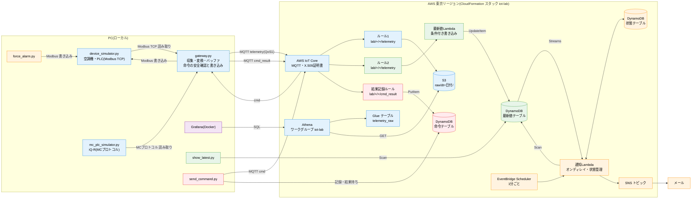

# IoT学習キット:アーキテクチャとコスト

Oct 12, 2026 · @Reo Kojima

学習キット全体(ハンズオン1〜5)の構成と、AWSの費用の目安をまとめたドキュメントです。ハンズオンを追加・変更したら、このドキュメントも合わせて更新します(手順は末尾の「このドキュメントの更新のしかた」)。コストの表は `tools/docs_sync.py` が自動で計算して書き込み、実装とのずれはGitHub Actionsで検査します。

## ハンズオン一覧

| # | 手順書 | 追加したもの | 図の色 |
| --- | --- | --- | --- |
| 1 | [PC+シミュレータ+AWS](./IoT学習ハンズオン%20PC%2Bシミュレータ%2BAWS.md) | シミュレータ、ゲートウェイ、IoT Core、S3、Glue、Athena | 青 |
| 2 | [Grafana可視化](./IoT学習ハンズオン2%20Grafana可視化.md) | ローカルDockerのGrafana、読み取り専用IAMユーザー | 紫 |
| 3 | [Lambda+DynamoDBで最新値を持つ](./IoT学習ハンズオン3%20Lambda%2BDynamoDB最新値.md) | ルール2、最新値Lambda、最新値テーブル、show_latest.py | 緑 |
| 4 | [アラーム通知](./IoT学習ハンズオン4%20アラーム通知.md) | DynamoDB Streams、通知Lambda、状態テーブル、SNS、Scheduler、force_alarm.py | 橙 |
| 5 | [遠隔操作](./IoT学習ハンズオン5%20遠隔操作.md) | 命令の受信と書き込み(ゲートウェイ)、命令テーブル、結果記録ルール、send_command.py | 赤 |

## 全体構成図

色は、そのものを追加したハンズオンを表します(青=1、紫=2、緑=3、橙=4、赤=5)。ゲートウェイとシミュレータはハンズオン1で作り、4と5で機能を足しています。

データの流れは3本です。

| 流れ | 経路 | 主なハンズオン |
| --- | --- | --- |
| テレメトリ(機器 → クラウド) | シミュレータ → ゲートウェイ → IoT Core → ルール1 → S3(履歴)/ ルール2 → Lambda → DynamoDB(現在値) | 1、3 |
| 通知(クラウド → 人) | 最新値テーブルの変化(Streams)と1分ごとの途絶チェック → 通知Lambda → SNS → メール | 4 |
| 命令(人 → 機器) | send_command.py → IoT Core → ゲートウェイ → 安全確認 → Modbus書き込み → 結果 → 命令テーブル | 5 |

PC側のGrafana(ハンズオン2)はAWSに何も常駐させず、読み取り専用のIAMユーザーでAthenaにSQLを投げるだけです。

## AWSリソース一覧

`iot-lab/aws/template.yaml` の全リソースです。この表と template.yaml は `python tools/docs_sync.py --check` で突き合わせています(1列目と2列目が対象)。

| 論理ID | 種類 | ハンズオン | 役割 | 課金 |
| --- | --- | --- | --- | --- |
| `DataBucket` | `AWS::S3::Bucket` | 1 | テレメトリの履歴(raw/)、ルールの失敗(errors/)、Athenaの結果 | PUT・GET回数、保存容量 |
| `GatewayThing` | `AWS::IoT::Thing` | 1 | ゲートウェイ gw01 の登録 | なし |
| `GatewayPolicy` | `AWS::IoT::Policy` | 1、5 | gw01 の接続・送信(1)、命令の購読・受信(5)の権限 | なし |
| `RuleRole` | `AWS::IAM::Role` | 1 | ルールがS3に書くためのロール | なし |
| `TelemetryToS3Rule` | `AWS::IoT::TopicRule` | 1 | ルール1:テレメトリを1件1ファイルでS3へ | 起動・アクション回数 |
| `GlueDatabase` | `AWS::Glue::Database` | 1 | Athena用データベース iot_lab | 無料枠内 |
| `TelemetryTable` | `AWS::Glue::Table` | 1 | telemetry_raw テーブル(パーティション射影) | 無料枠内 |
| `AthenaWorkGroup` | `AWS::Athena::WorkGroup` | 1 | 1クエリ1GBまでの上限付きワークグループ | スキャン量(1クエリ最低10MB) |
| `GrafanaUser` | `AWS::IAM::User` | 2 | Grafana用の読み取り専用ユーザー | なし |
| `GrafanaUserPolicy` | `AWS::IAM::Policy` | 2 | Athena・Glue・S3の読み取りだけを許可 | なし |
| `LatestTable` | `AWS::DynamoDB::Table` | 3、4 | 機器ごとの最新値(1台1行)。4でStreamsを有効化 | 書き込み回数 |
| `LatestValueLogGroup` | `AWS::Logs::LogGroup` | 3 | 最新値Lambdaのログ(7日保持) | 取り込み量 |
| `LatestValueRole` | `AWS::IAM::Role` | 3 | 最新値テーブルへのUpdateItemだけを許可 | なし |
| `LatestValueFunction` | `AWS::Lambda::Function` | 3 | 最新値Lambda(古い値で上書きしない) | 実行回数・時間 |
| `LatestValueRule` | `AWS::IoT::TopicRule` | 3 | ルール2:テレメトリをLambdaへ | 起動・アクション回数 |
| `LatestValuePermission` | `AWS::Lambda::Permission` | 3 | ルール2からだけLambdaを呼べる | なし |
| `AlarmTopic` | `AWS::SNS::Topic` | 4 | 通知メールの配信先 | 送信・配信回数 |
| `AlarmStateTable` | `AWS::DynamoDB::Table` | 4 | 通知済みで未復旧の異常(1異常1行) | 読み書き回数 |
| `AlarmNotifierLogGroup` | `AWS::Logs::LogGroup` | 4 | 通知Lambdaのログ(7日保持) | 取り込み量 |
| `AlarmNotifierRole` | `AWS::IAM::Role` | 4 | Streams読み取り、2テーブル、SNS送信の権限 | なし |
| `AlarmNotifierFunction` | `AWS::Lambda::Function` | 4 | 通知Lambda(異常・通信エラー・途絶の発生と復旧) | 実行回数・時間 |
| `AlarmStreamMapping` | `AWS::Lambda::EventSourceMapping` | 4 | 最新値テーブルのStreamsで通知Lambdaを起動(再試行3回) | なし(Streamsの読み取りは無料) |
| `StaleCheckSchedule` | `AWS::Scheduler::Schedule` | 4 | 1分ごとに途絶チェック | 実行回数 |
| `StaleCheckSchedulerRole` | `AWS::IAM::Role` | 4 | Schedulerが通知Lambdaを呼ぶためのロール | なし |
| `CommandTable` | `AWS::DynamoDB::Table` | 5 | 命令と結果の記録(監査ログ) | 読み書き回数 |
| `CommandRuleRole` | `AWS::IAM::Role` | 5 | 結果記録ルールが命令テーブルに書くためのロール | なし |
| `CommandResultRule` | `AWS::IoT::TopicRule` | 5 | 結果(cmd_result)を命令テーブルへ | 起動・アクション回数 |

スタックの外で作るもの:X.509証明書(`setup_aws.py` が発行、無料)、Grafana用アクセスキー(同)、SNSのメール購読(`--email` 指定時)。どれも `teardown_aws.py` で削除されます。

## コスト

### 前提

- 東京リージョン、1ドル=150円。単価は下の「単価表」(AWSの公開価格データから取得)
- 機器3台を10秒ごとに読み取り → テレメトリは1時間に1,080件、1か月(30日)で777,600件
- Lambda は128MBで1回50ms、ログは1回400バイトと見積もり
- 「無料枠適用後」は、Lambda・SNS・EventBridge Scheduler・CloudWatch Logs・Glueの**期限のない毎月の無料枠**を、このキットだけで使う前提で差し引いた金額。新規アカウントの無料プランのクレジットは差し引いていない
- ハンズオン2のGrafanaは、ダッシュボードの自動更新(30秒ごと、5パネル)で開いている時間だけ費用がかかる

### ケース別の見積もり

<!-- BEGIN:cost (tools/docs_sync.py が自動生成。手で編集しない) -->
#### 学習(ゲートウェイを3時間動かす)

| ハンズオン | 内訳 | 数量 | 料金(無料枠適用前) |
| --- | --- | --- | --- |
| 1 | テレメトリのMQTTメッセージ | 3,240 件 | 0.58円 |
| 1 | ゲートウェイの接続時間 | 180 接続分 | 0円 |
| 1 | ルール1(S3保存)の起動 | 3,240 回 | 0.09円 |
| 1 | ルール1のS3アクション | 3,240 回 | 0.09円 |
| 1 | S3 PUT(1メッセージ1ファイル) | 3,240 回 | 2円 |
| 1 | S3 保存容量 | 0.01未満 GB月 | 0円 |
| 1 | Athena 手動クエリのGET(当日の全ファイル) | 32,400 回 | 2円 |
| 1 | Athena 手動クエリのスキャン量 | 0.01未満 TB | 0.14円 |
| 1 | Glueデータカタログの参照 | 40 回 | 0.01円 |
| 2 | Grafana 自動更新のGET(当日の全ファイル) | 972,000 回 | 54円 |
| 2 | Grafana 自動更新のスキャン量 | 0.01未満 TB | 4円 |
| 2 | Grafana のGlue参照 | 1,200 回 | 0.18円 |
| 3 | ルール2(最新値)の起動 | 3,240 回 | 0.09円 |
| 3 | ルール2のLambdaアクション | 3,240 回 | 0.09円 |
| 3 | 最新値Lambdaの実行回数 | 3,240 回 | 0.10円 |
| 3 | 最新値Lambdaの実行時間(128MB×50ms) | 20 GB秒 | 0.05円 |
| 3 | 最新値テーブルへの書き込み | 3,240 WRU | 0.35円 |
| 3 | 最新値Lambdaのログ | 0.01未満 GB | 0.14円 |
| 4 | 通知Lambda(Streams、最大1件1回) | 3,240 回 | 0.10円 |
| 4 | 通知Lambda(1分ごとの途絶チェック) | 180 回 | 0.01円 |
| 4 | 通知Lambdaの実行時間(128MB×50ms) | 21 GB秒 | 0.05円 |
| 4 | EventBridge Scheduler | 180 回 | 0.03円 |
| 4 | 途絶チェックのScan(2テーブル) | 180 RRU | 0円 |
| 4 | 通知Lambdaのログ | 0.01未満 GB | 0.15円 |
| 4 | SNS 送信 | 20 回 | 0円 |
| 4 | SNS メール配信 | 20 通 | 0.06円 |
| 5 | 命令・受信・結果のMQTTメッセージ | 60 件 | 0.01円 |
| 5 | 結果記録ルールの起動 | 20 回 | 0円 |
| 5 | 結果記録ルールのDynamoDBアクション | 20 回 | 0円 |
| 5 | 命令テーブルへの書き込み(送信時+結果) | 40 WRU | 0円 |
| 5 | 結果待ちの読み取り(1秒ごと、約5回) | 100 RRU | 0円 |

| ハンズオン | 1 | 2 | 3 | 4 | 5 | 合計(無料枠適用前) | **合計(無料枠適用後)** |
| --- | --- | --- | --- | --- | --- | --- | --- |
| 料金 | 5円 | 58円 | 0.81円 | 0.40円 | 0.02円 | 65円 | **64円** |

#### 1か月つけっぱなし(Grafanaは開かない)

| ハンズオン | 内訳 | 数量 | 料金(無料枠適用前) |
| --- | --- | --- | --- |
| 1 | テレメトリのMQTTメッセージ | 777,600 件 | 140円 |
| 1 | ゲートウェイの接続時間 | 43,200 接続分 | 0.62円 |
| 1 | ルール1(S3保存)の起動 | 777,600 回 | 21円 |
| 1 | ルール1のS3アクション | 777,600 回 | 21円 |
| 1 | S3 PUT(1メッセージ1ファイル) | 777,600 回 | 548円 |
| 1 | S3 保存容量 | 0.18 GB月 | 0.68円 |
| 1 | Athena 手動クエリのGET(当日の全ファイル) | 259,200 回 | 14円 |
| 1 | Athena 手動クエリのスキャン量 | 0.01未満 TB | 0.14円 |
| 1 | Glueデータカタログの参照 | 40 回 | 0.01円 |
| 3 | ルール2(最新値)の起動 | 777,600 回 | 21円 |
| 3 | ルール2のLambdaアクション | 777,600 回 | 21円 |
| 3 | 最新値Lambdaの実行回数 | 777,600 回 | 23円 |
| 3 | 最新値Lambdaの実行時間(128MB×50ms) | 4,860 GB秒 | 12円 |
| 3 | 最新値テーブルへの書き込み | 777,600 WRU | 83円 |
| 3 | 最新値Lambdaのログ | 0.29 GB | 33円 |
| 4 | 通知Lambda(Streams、最大1件1回) | 777,600 回 | 23円 |
| 4 | 通知Lambda(1分ごとの途絶チェック) | 43,200 回 | 1円 |
| 4 | 通知Lambdaの実行時間(128MB×50ms) | 5,130 GB秒 | 13円 |
| 4 | EventBridge Scheduler | 43,200 回 | 8円 |
| 4 | 途絶チェックのScan(2テーブル) | 43,200 RRU | 0.92円 |
| 4 | 通知Lambdaのログ | 0.31 GB | 35円 |

| ハンズオン | 1 | 2 | 3 | 4 | 5 | 合計(無料枠適用前) | **合計(無料枠適用後)** |
| --- | --- | --- | --- | --- | --- | --- | --- |
| 料金 | 746円 | 0円 | 194円 | 81円 | 0円 | 1,021円 | **890円** |
<!-- END:cost -->

### 費用の注意点

**1. 一番大きいのはS3のPUT(1メッセージ1ファイル)**:つけっぱなしの費用の半分以上は、ルール1がメッセージを1件ずつS3に保存するときのPUT料金です。学習用には仕組みが見えやすい形ですが、実運用では Amazon Data Firehose で数分ぶんをまとめて1ファイルにするのが定石です(PUTが数百分の1になり、Athenaも速くなります)。

**2. Grafanaを開いたままにしない**:Athenaは、クエリのたびに当日のパーティションの**全ファイルをS3からGET**します。ダッシュボードは30秒ごとに5パネル分のクエリを投げるので、データがたまるほど高くなります。

<!-- BEGIN:grafana (tools/docs_sync.py が自動生成。手で編集しない) -->
| その日にたまったファイル数 | 目安 | 1時間開いたままにしたときの料金 |
| --- | --- | --- |
| 1,000 | ゲートウェイを約1時間動かした | 38円 |
| 10,000 | 約9時間動かした | 337円 |
| 25,920 | 24時間動かした(1日分) | 867円 |
<!-- END:grafana -->

使い終わったらブラウザのタブを閉じるか、ダッシュボード右上の自動更新を「Off」にしてください。ファイルを小さく分けすぎると読む側が高くつくのも、1と同じ「小さいファイル問題」です。

**3. 時間課金のものは無い**:すべて件数・量での課金です。ゲートウェイを止め、Grafanaを閉じれば、費用はほぼ止まります(S3の保存容量だけは残りますが、月1円未満)。学習が終わったら `python aws/teardown_aws.py` で全部削除できます。

**4. 予算アラートを設定しておく**:ハンズオン1の準備にある通り、Budgetsで月5ドル程度の予算アラートを設定しておくと、想定外の課金に早く気づけます。

### 単価表

<!-- BEGIN:prices (tools/docs_sync.py が自動生成。手で編集しない) -->
東京リージョン(ap-northeast-1)、AWS Price List の公開データより。取得日: 2026-10-12。1ドル=150円で換算。

| 単価キー | 単価(USD) | 単位 | 毎月の無料枠 |
| --- | --- | --- | --- |
| iot_message | 1.2e-06 | 1 件(AWSIoT APN1-Messages) | - |
| iot_connection_minute | 9.6e-08 | 1 接続分(AWSIoT APN1-ConnectionMinutes) | - |
| iot_rule_triggered | 1.8e-07 | 1 回(AWSIoT APN1-RulesTriggered) | - |
| iot_action_executed | 1.8e-07 | 1 回(AWSIoT APN1-ActionsExecuted) | - |
| lambda_request | 2e-07 | 1 回(AWSLambda APN1-Request) | 1,000,000 回 |
| lambda_gb_second | 1.66667e-05 | 1 GB秒(AWSLambda APN1-Lambda-GB-Second) | 400,000 GB秒 |
| ddb_write_request_unit | 7.15e-07 | 1 WRU(AmazonDynamoDB APN1-WriteRequestUnits) | - |
| ddb_read_request_unit | 1.425e-07 | 1 RRU(AmazonDynamoDB APN1-ReadRequestUnits) | - |
| s3_put_request | 4.7e-06 | 1 回(AmazonS3 APN1-Requests-Tier1) | - |
| s3_get_request | 3.7e-07 | 1 回(AmazonS3 APN1-Requests-Tier2) | - |
| s3_storage_gb_month | 0.025 | 1 GB月(AmazonS3 APN1-TimedStorage-ByteHrs) | - |
| athena_scanned_tb | 5 | 1 TB(AmazonAthena APN1-DataScannedInTB) | - |
| logs_ingest_gb | 0.76 | 1 GB(AmazonCloudWatch APN1-VendedLog-Bytes) | 5 GB |
| scheduler_invocation | 1.25e-06 | 1 回(AWSEvents APN1-ScheduledInvocation) | 14,000,000 回 |
| sns_request | 5e-07 | 1 回(AmazonSNS APN1-Requests-Tier1) | 1,000,000 回 |
| sns_email | 2e-05 | 1 通(AmazonSNS APN1-DeliveryAttempts-SMTP) | 1,000 通 |
| glue_catalog_request | 1e-06 | 1 回(AWSGlue APN1-Catalog-Request) | 1,000,000 回 |
<!-- END:prices -->

## このドキュメントの更新のしかた

ハンズオンを追加・変更して、AWSのリソースや、メッセージ・Lambda・テーブルの件数が変わったら、同じ変更の中で次を行います。

1. **ハンズオン一覧**に行を足し、手順書へのリンクを張る
2. **全体構成図**(mermaid)にノードと矢印を足し、`class` 行でそのハンズオンの色を付ける(新しいハンズオンなら `classDef` も足す)
3. **AWSリソース一覧**に、template.yaml に追加したリソースの行を足す(削除したリソースは行も消す)
4. **使用量モデル**:`tools/docs_sync.py` の `usage()` に、そのハンズオンで増える件数の行を足す。新しいサービスを使う場合は `PRICE_SOURCES`(と無料枠があれば `FREE_TIER`)にも足し、`python tools/docs_sync.py --update-prices` で単価を取り直す
5. `python tools/docs_sync.py` でコスト表を作り直し、`python tools/docs_sync.py --check` が OK になることを確認する

単価はAWSの価格改定で変わります。半年に1回程度、またはハンズオンを追加したときに `--update-prices` で取り直してください。

`--check` は GitHub Actions(`.github/workflows/docs-check.yml`)でも push と プルリクエストのたびに実行されます。リソース一覧の漏れ、手順書のリンク漏れ、コスト表の更新漏れがあると失敗します。構成図の中身は自動では検査できないので、レビューで確認してください。
