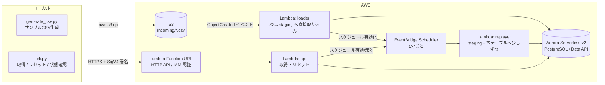

# 工場データ CSV リプレイ基盤 実現方針

工場内のサンプルデータを CSV で用意し、S3 にアップロードすると RDB に「少しずつ」反映され、
その RDB からデータを取得でき、いつでもリセットして最初から流し直せる仕組みを、低コストで作る。

## 1. 全体像



ポイントは **「CSV を一度 staging テーブルに全部入れておき、本テーブルへは時間に応じて少しずつコピーする」** こと。
こうすると「少しずつ反映」は 1 本の SQL で済み、リセットも S3 を触らずに DB の中だけで完結する。

### 決定事項（2026-10-24）

| 項目 | 決定 |
|---|---|
| 命名 | 共有アカウント前提で、オーナー付きプレフィックス `xcp-factory-<owner>` を使う（`setup_aws.py --owner` で指定）。Glue 等ハイフン不可の箇所は `xcp_factory_<owner>` |
| 再生速度 | 検証時間の短縮とコストを優先し、**既定は 60 倍速**（1 日分を約 24 分で再生）。`--speed` で変更可 |
| データ量 | 大きめのデータ（数日〜1 か月分、数十万〜百万行規模）も扱う。CSV 取り込みは **S3 から DB への直接取り込み**（`aws_s3` 拡張）を標準にする |
| 取得手段 | **HTTP API を最初から用意する**（Lambda Function URL + IAM 認証）。CLI も内部ではこの HTTP API を呼ぶ |

## 2. 技術選定（低コスト観点）

### RDB

| 案 | 月額の目安 | 長所 | 短所 |
|---|---|---|---|
| **A. Aurora Serverless v2（最小 0 ACU・自動一時停止）+ Data API**（推奨） | 停止中はストレージ代のみ。リプレイ中だけ ACU 課金 | 使わない時はほぼ 0 円。Data API で Lambda を VPC に入れなくてよい（NAT 不要）。通常の PostgreSQL なので TRUNCATE 等が素直に使える | 停止からの再開に十数秒かかる（初回呼び出しはリトライが必要） |
| B. Aurora DSQL | 従量課金・無料枠あり。最安になりやすい | 完全サーバーレス、VPC 不要、IAM 認証 | PostgreSQL 互換だが制約あり（1 トランザクションの行数上限、一部機能未対応など）。学習用途で「普通の RDB」として扱いにくい |
| C. RDS PostgreSQL db.t4g.micro | 常時起動の固定費（停止しても 7 日で自動起動） | 最もシンプル | 使っていなくても課金。Lambda を VPC に入れる必要があり、他サービス呼び出しに VPC エンドポイント（有料）が要る |

→ **案 A を採用**。リプレイ中しか DB が起きないため、「たまに検証で流す」使い方では最も費用が読みやすい。
（料金は東京リージョンの最新単価で構築前に再確認する）

### その他

| 役割 | 採用 | 理由 |
|---|---|---|
| CSV 置き場 | S3（`incoming/` プレフィックス） | ほぼ無料。S3 イベント通知で Lambda を直接起動（追加費用なし） |
| CSV 取り込み | Aurora の `aws_s3.table_import_from_s3`（DB が S3 から直接 COPY） | 大きな CSV でも Lambda のメモリや Data API のサイズ上限に縛られない。DB から S3 へは S3 ゲートウェイ型 VPC エンドポイント（無料）で到達 |
| 少しずつ反映の駆動 | EventBridge Scheduler（rate 1 分）+ Lambda | 無料枠が大きい。Step Functions の Wait ループより単純 |
| 進捗（カーソル）管理 | RDB 内の `replay_state` テーブル | DynamoDB 等を追加しない |
| 取得 API | Lambda Function URL（`AWS_IAM` 認証）+ Lambda（Data API で DB 参照） | Function URL 自体は無料で、API Gateway の料金がかからない。Lambda は VPC 外に置ける |
| 構築 | CloudFormation 1 スタック（`setup_aws.py` が boto3 でデプロイ） | 作成・削除を 1 コマンドで。SAM CLI 等の追加ツールは不要。共有アカウントでも衝突しない命名にする |
| DB 認証情報 | RDS 管理のマスターユーザーシークレット（`ManageMasterUserPassword`） | Data API の必須要件。パスワードをテンプレートやコードに一切書かない（約 $0.40/月） |

## 3. ① サンプル CSV

### 題材（工場の 1 ライン）

| 設備 ID | 設備 | 主なメトリクス |
|---|---|---|
| PRESS-01 | プレス機 | 稼働状態、ショット数、油圧、モータ電流 |
| CNC-01 | CNC 加工機 | 稼働状態、主軸回転数、主軸負荷、加工数 |
| CONV-01 | 搬送コンベア | 速度、モータ温度 |
| COMP-01 | エアコンプレッサ | 吐出圧力、消費電力 |
| ENV-01 | 工場内環境センサ | 温度、湿度、CO2 |

### フォーマット（縦持ち）

```csv
ts,line_id,equipment_id,metric,value,unit
2026-10-01T08:00:00+09:00,LINE-A,PRESS-01,hydraulic_pressure,14.8,MPa
2026-10-01T08:00:00+09:00,LINE-A,PRESS-01,status,1,
2026-10-01T08:00:00+09:00,LINE-A,ENV-01,temperature,24.3,degC
```

- 縦持ち（1 行 1 計測値）にして、設備やメトリクスを増やしてもテーブル定義を変えずに済むようにする
- `generate_csv.py` で生成（乱数シード固定で再現可能）。CSV は時刻順に並べて出力する
  - 既定は **1 分間隔 × 1 日分 ≒ 2 万行**
  - `--days` / `--interval` / `--lines`（ライン数）で大きめのデータも作れる

    | 例 | 行数 | ファイルサイズ |
    |---|---|---|
    | `--days 1` | 21,600 行 | 約 1.3 MB |
    | `--days 7` | 151,200 行 | 約 9 MB |
    | `--days 30` | 648,000 行 | 約 39 MB |
    | `--days 30 --interval 10s` | 3,888,000 行 | 約 230 MB |

  - 稼働時間は平日 6:00〜22:00（2 交代）、昼休み 12:00〜13:00 は計画停止、夜間と土日は停止

  - リポジトリには 1 日分だけコミットし、大きいデータは各自ローカルで生成する（`data/*.large.csv` は `.gitignore`）
- 分析の題材になるよう、意図的なイベントを仕込む
  - 昼休み（12:00–13:00）の計画停止
  - CNC-01 の主軸負荷上昇 → チョコ停
  - COMP-01 の圧力低下（エア漏れ想定）
  - 夕方の室温上昇
- 生成済みサンプルも `data/` にコミットしておき、スクリプトを動かさなくても試せるようにする

## 4. ② S3 アップロード → RDB に少しずつ反映

### テーブル

（確定版の定義は `factory-replay/aws/schema.sql`。以下は概要）

```sql
-- CSV をそのまま全部入れる（リプレイの元データ）
CREATE TABLE staging_readings (
  seq          BIGINT GENERATED ALWAYS AS IDENTITY PRIMARY KEY,  -- 取り込み順 = CSV の行順
  ts           TIMESTAMPTZ NOT NULL,    -- CSV 上の元時刻
  line_id      TEXT, equipment_id TEXT, metric TEXT,
  value        DOUBLE PRECISION, unit TEXT
);
CREATE INDEX ON staging_readings (ts);

-- 利用者が参照する本テーブル（少しずつ増える）
CREATE TABLE readings (
  seq          BIGINT PRIMARY KEY,
  ts           TIMESTAMPTZ NOT NULL,    -- 反映時刻に読み替えた時刻
  source_ts    TIMESTAMPTZ NOT NULL,    -- CSV 上の元時刻
  line_id      TEXT, equipment_id TEXT, metric TEXT,
  value        DOUBLE PRECISION, unit TEXT
);
CREATE INDEX ON readings (equipment_id, metric, ts);

-- リプレイの進捗（1 行のみ）
CREATE TABLE replay_state (
  id           INT PRIMARY KEY DEFAULT 1,
  source_key   TEXT,                    -- 元にした S3 キー
  status       TEXT,                    -- idle / running / done
  started_at   TIMESTAMPTZ,
  base_ts      TIMESTAMPTZ,             -- CSV 先頭の元時刻（min(ts)）
  total_rows   BIGINT,
  speed        REAL DEFAULT 60,         -- 再生倍率（60 なら 1 分で 1 時間分）
  cursor_seq   BIGINT DEFAULT 0
);
```

### 流れ

1. `aws s3 cp factory.csv s3://<bucket>/incoming/` でアップロード
2. S3 イベントで **loader** Lambda が起動し、Data API 経由で DB に S3 から直接取り込ませる

   ```sql
   TRUNCATE staging_readings RESTART IDENTITY;
   SELECT aws_s3.table_import_from_s3(
     'staging_readings', 'ts,line_id,equipment_id,metric,value,unit',
     '(FORMAT csv, HEADER true)',
     aws_commons.create_s3_uri(:bucket, :key, 'ap-northeast-1'));
   ```

   - CSV のデータは Lambda を通らないので、ファイルが大きくても Lambda のメモリや Data API のサイズ上限は関係ない
   - 取り込み後、`readings` を TRUNCATE し、`replay_state` を `running / started_at=now / base_ts=min(ts) / total_rows / cursor=0` にする
   - EventBridge Scheduler のスケジュールを有効化
3. 1 分ごとに **replayer** Lambda が起動し、経過時間ぶんの行だけを本テーブルへコピー（DB 内で完結する INSERT ... SELECT）

   ```sql
   INSERT INTO readings (seq, ts, source_ts, line_id, equipment_id, metric, value, unit)
   SELECT seq,
          :started_at + (ts - :base_ts) / :speed,
          ts, line_id, equipment_id, metric, value, unit
   FROM staging_readings
   WHERE seq > :cursor
     AND ts <= :base_ts + (now() - :started_at) * :speed
   ORDER BY seq
   LIMIT 50000
   ON CONFLICT (seq) DO NOTHING;
   ```

   - コピーした最大 `seq` を `cursor_seq` に保存。1 回の起動で追いつかなければ、Lambda 内で上限時間までバッチを繰り返す
   - 全行コピーし終えたら `status=done` にしてスケジュールを無効化 → DB は自動一時停止へ
4. `speed` で再生速度を調整（既定 60 倍）

   | データ量 | 60 倍速での再生時間 | 1 分あたりの反映行数（1 分間隔データ） |
   |---|---|---|
   | 1 日分 | 約 24 分 | 約 900 行 |
   | 7 日分 | 約 2.8 時間 | 約 900 行 |
   | 30 日分 | 約 12 時間 | 約 900 行 |

   30 日分のような大きいデータは、`--speed 720`（30 日を 1 時間）など倍率を上げて流す想定。
   倍率を上げると 1 分あたりの反映行数が増える（720 倍なら約 1 万行/分）が、DB 内のコピーなので問題ない範囲

### 設計上の注意

- **冪等性**: `seq` を主キーにし、`ON CONFLICT DO NOTHING` で二重起動・リトライ時も重複しない
- **DB 再開待ち**: 一時停止中の初回 Data API 呼び出しは失敗し得るので、Lambda 側で指数バックオフのリトライを入れる
- **取り込みの所要時間**: Data API の 1 呼び出しは数十秒で応答を打ち切るため、大きい CSV の取り込みは `continueAfterTimeout=true` で投げ、完了は `replay_state` の更新で判定する（loader は取り込みの最後に状態更新まで同じ SQL で行う）
- **S3 取り込みの前提**: Aurora クラスターに S3 読み取り用の IAM ロールを関連付け、VPC に S3 ゲートウェイエンドポイントを置く（どちらも無料）
- **ACU 上限**: 大きな取り込み中は ACU が上がるため、最大 ACU を 2〜4 程度に制限して費用の上振れを防ぐ
- **時刻の扱い**: 本テーブルの `ts` は「反映した時刻」に読み替え、元時刻は `source_ts` に残す。ダッシュボード等で「今流れているデータ」に見せられる

## 5. ③ RDB からデータを取得

**Lambda Function URL による HTTP API** を用意し、取得もリセット（④）も同じ API で行う。
1 つの Lambda（`api`）がパスで処理を振り分ける。

### エンドポイント

| メソッド・パス | 内容 | 主なパラメータ |
|---|---|---|
| `GET /latest` | 設備・メトリクスごとの最新値 | `equipment`（任意） |
| `GET /readings` | 時系列データ | `equipment`, `metric`, `from`, `to`（ISO 8601）または `minutes`, `limit`, `next` |
| `GET /summary` | 設備ごとの平均・最大・最小、停止時間 | `minutes`（既定 60）, `equipment` |
| `GET /status` | リプレイ進捗（反映件数 / 全件数、%、残り時間の目安、速度、元 CSV） | なし |
| `POST /reset` | ④ リセット | JSON `{"speed": 60, "stop": false}` |

レスポンス例（`GET /readings?equipment=CNC-01&metric=spindle_load&minutes=30`）:

```json
{
  "items": [
    {"ts": "2026-10-24T10:00:00+09:00", "source_ts": "2026-10-01T08:00:00+09:00",
     "equipment_id": "CNC-01", "metric": "spindle_load", "value": 62.4, "unit": "%"}
  ],
  "next": "184233"
}
```

### 設計方針

- **認証**: Function URL は `AWS_IAM` 認証。呼び出しには `lambda:InvokeFunctionUrl` 権限と SigV4 署名が必要なので、URL が漏れても第三者は呼べない
- **ページング**: 大きいデータを扱うため、`/readings` は `limit`（既定 1,000、上限 10,000）と `next`（最後の `seq`）によるキーセット方式。
  Data API の応答サイズ上限（1 MB）と Function URL の応答サイズ上限（6 MB）に収まるようにする
- **入力チェック**: 設備 ID・メトリクスは英数字とハイフンに限定し、SQL はすべてパラメータバインド
- **DB 停止中の応答**: DB が一時停止から再開中の場合は、Lambda 内で短くリトライし、それでも間に合わなければ `503` と `Retry-After` を返す
- **SQL の共有**: SQL は `queries.sql` にまとめ、マネジメントコンソールの「クエリエディタ」でもそのまま試せるようにする

### 呼び出し方

```
# CLI（内部で SigV4 署名して HTTP API を呼ぶ。URL はスタック出力から自動取得）
python cli.py latest
python cli.py readings --equipment CNC-01 --metric spindle_load --minutes 30
python cli.py readings --equipment CNC-01 --from 2026-10-01T08:00 --to 2026-10-02T08:00 --all   # ページを自動でたどる
python cli.py summary --minutes 60
python cli.py status

# curl（7.75 以降は SigV4 署名に対応）
curl --aws-sigv4 "aws:amz:ap-northeast-1:lambda" \
     --user "$AWS_ACCESS_KEY_ID:$AWS_SECRET_ACCESS_KEY" \
     -H "x-amz-security-token: $AWS_SESSION_TOKEN" \
     "https://<url-id>.lambda-url.ap-northeast-1.on.aws/latest"
```

## 6. ④ リセットして最初からやり直す

```
python cli.py reset            # 本テーブルを空にし、同じ CSV で最初から再生
python cli.py reset --speed 720 # 再生速度を変えてやり直し
python cli.py reset --stop     # 空にするだけ（再生しない）
```

CLI は HTTP API の `POST /reset` を呼ぶ（curl 等から直接呼んでもよい）。`api` Lambda での処理内容:

1. スケジュールを一時無効化（実行中の replayer と競合させない）
2. 1 トランザクションで
   - `TRUNCATE readings`
   - `replay_state` を `running / started_at=now / cursor_seq=0`（`--stop` 時は `idle`）
3. スケジュールを有効化

- `staging_readings` は残しているので **S3 への再アップロードは不要**
- 別の CSV で始めたいときは、その CSV を `incoming/` にアップロードすればよい（②の流れで自動的にリセットされる）

## 7. コスト目安（東京リージョン・検証用途）

| 項目 | 想定 | 目安 |
|---|---|---|
| Aurora Serverless v2 | 0.5〜1 ACU × リプレイ中のみ（例: 月 20 時間）、取り込み時は一時的に最大 4 ACU | 数ドル |
| Aurora ストレージ | 百万行規模でも staging + readings で 1 GB 程度 | 1 ドル未満 |
| Secrets Manager | 1 シークレット | 約 $0.40 |
| Lambda / Scheduler / S3 | 1 分ごと起動 程度 | 無料枠内 |
| HTTP API（Function URL） | Function URL 自体は無料。Lambda 実行分のみ | 無料枠内 |
| **合計** | | **月数ドル程度** |

- 常時リプレイ（24 時間 × 30 日）にすると Aurora の ACU 課金が支配的になり数十ドル規模になる。既定を 60 倍速にしているのはこのため（短時間で流し終えて DB を停止させる）
- 使わなくなったら `teardown` でスタックごと削除する

### 実測（2026-10-24、東京リージョン単価）

- 単価: Aurora Serverless v2 **$0.15 / ACU 時**、ストレージ **$0.12 / GB 月**（標準ストレージ。I/O は別途少額）
- 1 日分（21,600 行）を 60 倍速で再生した時間帯の平均は **約 0.8 ACU**（最大 4 ACU）。1 回のリプレイ（約 25 分 + 停止までの 5 分）で **約 $0.1**
- リプレイしていない時間帯は **0 ACU**（一時停止）を確認
- 課金が膨らむのは「DB が止まらない」場合だけで、その上限は最大 ACU で決まる（4 ACU × 24 時間 × 30 日 ≒ $430/月が理論上の最大）。止まらなくなる要因と対策:

  | 要因 | 対策 |
  |---|---|
  | リプレイ完了後もスケジュールが動き続ける | replayer が `done` で自動停止。`running` 以外の状態でも停止する |
  | loader が途中で落ちて `loading` のまま残る | replayer が 60 分以上 `loading` のものを `error` にして停止する |
  | クエリエディタや外部ツールから定期的に SQL を投げ続ける | 利用者の運用で注意（投げ続ける限り DB は止まらない） |
  | 大きいデータを低速で長時間再生する | 30 日分なら倍率を上げる（`--speed 720` で約 1 時間） |

- 念のため AWS Budgets で月額アラート（例: $10）を設定しておくと安心

## 8. ディレクトリ構成案

```
factory-replay/
├── data/
│   └── factory_sample.csv      # 生成済みサンプル
├── tools/
│   ├── generate_csv.py         # ① サンプル CSV 生成
│   └── cli.py                  # ③ 取得 / ④ リセット / 状態確認（HTTP API を呼ぶ）
├── aws/
│   ├── template.yaml           # CloudFormation: VPC, S3, Aurora, Lambda, Function URL, Scheduler, IAM
│   ├── schema.sql              # テーブル定義 + start_replay()（取り込み〜リプレイ開始を 1 トランザクションで）
│   ├── queries.sql             # 取得用 SQL 集
│   ├── lambda/
│   │   ├── loader.py           # ② S3 イベント → start_replay() 呼び出し
│   │   ├── replayer.py         # ② staging → readings（少しずつ）
│   │   ├── schedule.py         # ② スケジュールの有効化・無効化
│   │   └── api.py              # ③ 取得 + ④ リセットの HTTP API（Function URL）
│   ├── dataapi.py              # Data API 共通処理（Lambda の zip にも同梱）
│   ├── naming.py               # 命名ルール（xcp-factory-<owner>）
│   ├── setup_aws.py            # Lambda コードのアップロード + デプロイ + スキーマ作成（--owner 指定）
│   └── teardown_aws.py         # 全削除
└── README.md
```

## 9. 進め方

| ステップ | 内容 | 完了条件 |
|---|---|---|
| 1 | CSV 生成スクリプトとサンプル CSV | 1 日分の CSV がローカルで作れる |
| 2 | CloudFormation テンプレート（VPC / S3 / Aurora）とスキーマ作成 | `setup_aws.py` でスタック作成、テーブルができる |
| 3 | loader / replayer / Scheduler | アップロード後、`readings` が 1 分ごとに増える |
| 4 | HTTP API（`/latest` `/readings` `/summary` `/status`）と CLI | CLI と curl の両方で最新値・時系列・進捗が取れる。署名なしの呼び出しは 403 になる |
| 5 | リセット（`POST /reset`） | `reset` 後に件数 0 から再び増え始める |
| 6 | README・後片付け | `teardown_aws.py` で課金リソースが残らない |

## 10. 決めておきたいこと

方針レベルの未決事項はなし（命名・再生速度・データ量・取得手段は「1. 全体像」の決定事項を参照）。
