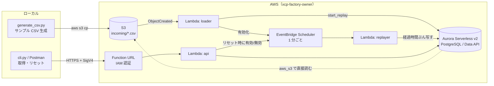
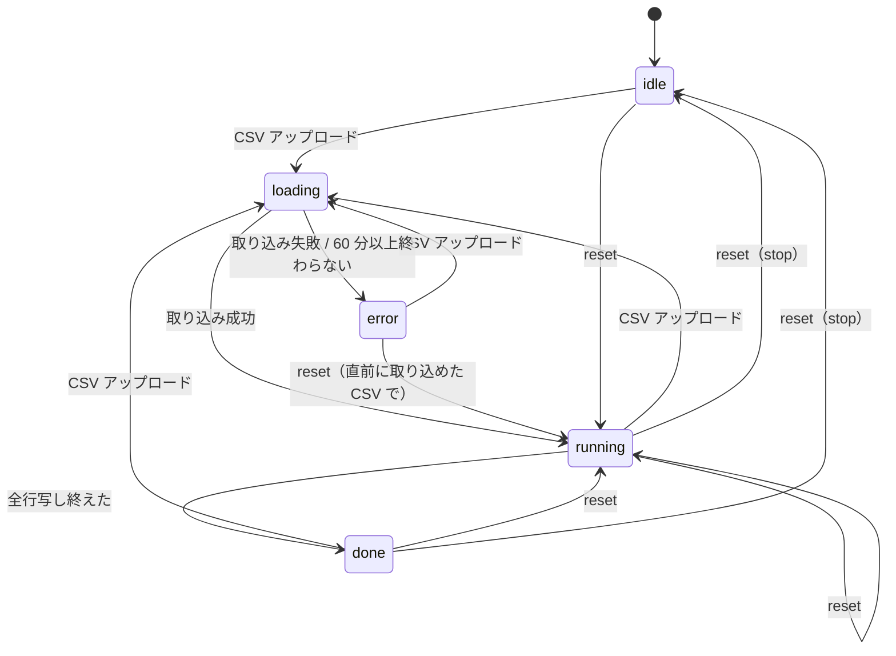

# 工場データ CSV リプレイ基盤 実現方針

工場ラインのサンプルデータを CSV で用意し、S3 にアップロードすると RDB に「少しずつ」反映され、
その RDB からデータを取得でき、いつでもリセットして最初から流し直せる仕組みを、低コストで作る。

- 実装: [factory-replay/](../factory-replay/)（使い方は [README](../factory-replay/README.md)）
- AWS での確認手順: [作業手順.md](作業手順.md)

## 1. 要件と決定事項

| # | 要件 | 実現方法 |
|---|---|---|
| ① | 工場内のサンプルデータをまとめた CSV | `tools/generate_csv.py` で生成（1 日分を同梱、日数・間隔・ライン数で大きくできる） |
| ② | CSV を S3 にアップロードすると RDB に少しずつ反映 | S3 イベント → DB が CSV を直接取り込み → 1 分ごとに「経過時間 × 速度」ぶんを本テーブルへ |
| ③ | RDB からデータを取得 | HTTP API（Lambda Function URL、IAM 認証）。Postman / CLI から呼ぶ |
| ④ | RDB をリセットし ② を最初からやり直す | `POST /reset`。S3 は読み直さず、DB 内の元データから再生し直す |

決定事項（2026-10-24）:

| 項目 | 決定 |
|---|---|
| 命名 | 共有アカウント前提で、すべてのリソース名をオーナー付きの `xcp-factory-<owner>` から作る |
| 再生速度 | 検証時間の短縮とコストを優先し、**既定は 60 倍速**（1 日分を約 24 分）。リセット時に変更できる |
| データ量 | 数日〜1 か月分（数百万行・数百 MB）も扱う。CSV は Lambda を通さず **DB が S3 から直接取り込む** |
| 取得手段 | **HTTP API を最初から用意する**。手動確認は Postman、全件取得・リセットなどの操作は CLI |
| リセット | S3 の CSV には触れない（消さない・読み直さない）。不要な CSV の自動削除もしない |

## 2. 全体構成



ポイントは **「CSV を一度 staging テーブルに全部入れておき、本テーブルへは時間に応じて少しずつ写す」** こと。
「少しずつ反映」は DB 内で完結する 1 本の SQL で済み、リセットも S3 を触らずに DB の中だけで完結する。

## 3. 技術選定（低コスト観点）

### RDB

| 案 | 費用 | 長所 | 短所 |
|---|---|---|---|
| **A. Aurora Serverless v2（最小 0 ACU・自動一時停止）+ Data API**（採用） | 停止中はストレージ代のみ。動いている間だけ ACU 課金 | 使わない時はほぼ 0 円。Data API で Lambda を VPC に入れなくてよい（NAT 不要）。普通の PostgreSQL として使える | 一時停止からの再開に十数秒かかる（呼び出し側でリトライが必要） |
| B. Aurora DSQL | 従量課金・無料枠あり | 完全サーバーレス、VPC 不要 | PostgreSQL 互換だが制約があり（トランザクションの行数上限など）、大量行の取り込み・一括削除に向かない |
| C. RDS PostgreSQL db.t4g.micro | 常時起動の固定費（停止しても 7 日で自動起動） | 最もシンプル | 使っていなくても課金。Lambda を VPC に入れる必要があり、AWS サービス呼び出しに有料の VPC エンドポイントが要る |

→ **A を採用**。リプレイ中しか DB が起きないため、「たまに検証で流す」使い方で最も安く、費用も読みやすい。

### その他

| 役割 | 採用 | 理由 |
|---|---|---|
| CSV 置き場 | S3（`incoming/*.csv`） | ほぼ無料。S3 イベント通知で Lambda を直接起動（追加費用なし） |
| CSV 取り込み | Aurora の `aws_s3.table_import_from_s3`（DB が S3 から直接 COPY） | 大きな CSV でも Lambda のメモリ・実行時間・Data API のサイズ上限に縛られない。DB から S3 へは無料の S3 ゲートウェイエンドポイント経由 |
| 少しずつ反映の駆動 | EventBridge Scheduler（rate 1 分）+ Lambda | 無料枠内。リプレイ中だけ有効にし、終わったら止める |
| 進捗管理 | DB 内の `replay_state` テーブル（1 行） | DynamoDB 等を追加しない |
| 取得 API | Lambda Function URL（`AWS_IAM` 認証） | Function URL 自体は無料（API Gateway 不要）。Lambda は VPC 外 |
| DB 認証情報 | RDS 管理のマスターユーザーシークレット | Data API の必須要件。パスワードをテンプレート・コードに書かない |
| 構築 | CloudFormation 1 スタック + `setup_aws.py`（boto3） | SAM CLI 等の追加ツール不要。作成・更新・削除を 1 コマンドで |
| Lambda | Python 3.13・arm64・256〜512 MB | arm64 の方が安い。重い処理は DB 側で行うので小さいメモリで足りる |

## 4. データ設計

### CSV（縦持ち）

```csv
ts,line_id,equipment_id,metric,value,unit
2026-10-01T08:00:00+09:00,LINE-A,PRESS-01,hydraulic_pressure,14.8,MPa
2026-10-01T08:00:00+09:00,LINE-A,PRESS-01,status,1,
```

- 1 行 1 計測値（縦持ち）。設備やメトリクスを増やしてもテーブル定義を変えずに済む
- 時刻順に並んでいること（リプレイは CSV の行順 = 時刻順を前提にしている）
- 題材は 1 ライン 5 設備・15 メトリクス（プレス機・CNC・コンベア・コンプレッサ・環境センサ）。
  分析の題材として、昼休みの計画停止、CNC のチョコ停、コンプレッサのエア漏れ、夕方の室温上昇を仕込んである
  （詳細は [README](../factory-replay/README.md) の「① サンプル CSV」）

| 生成例 | 行数 | サイズ |
|---|---|---|
| 1 日分・1 分間隔（同梱） | 21,600 | 約 1.3 MB |
| 7 日分 | 151,200 | 約 9 MB |
| 30 日分 | 648,000 | 約 39 MB |
| 30 日分・10 秒間隔 | 3,888,000 | 約 230 MB |

### テーブル（定義は [`aws/schema.sql`](../factory-replay/aws/schema.sql)）

| テーブル | 役割 | 主な列 |
|---|---|---|
| `staging_readings` | CSV の全行（リプレイの元データ） | `seq`（取り込み順 = CSV の行順）、`ts`（CSV 上の時刻）、`line_id` / `equipment_id` / `metric` / `value` / `unit` |
| `readings` | 利用者が参照する本テーブル（少しずつ増える） | `seq`、`ts`（**反映時刻**に読み替えた時刻）、`source_ts`（CSV 上の時刻）、ほか同上 |
| `replay_state` | リプレイの進捗（常に 1 行） | `status`、`source_key`（staging に入っている CSV）、`started_at`、`base_ts`（CSV 先頭時刻）、`total_rows`、`speed`、`cursor_seq`（どこまで写したか）、`message` |

- `readings.ts` を反映時刻に読み替えることで、ダッシュボード等から「いま流れているデータ」として扱える。元の時刻は `source_ts` に残す
- 索引: `staging_readings(ts)`、`readings(equipment_id, metric, ts)`、`readings(ts)`

### 状態遷移（`replay_state.status`）



## 5. 処理設計

### ② 取り込み（loader → `start_replay()`）

1. `incoming/*.csv` の作成イベントで loader が起動。スケジュールを止め、`status = loading` にする
2. DB 関数 `start_replay(bucket, key, region)` を呼ぶ。**1 トランザクション**で次を行う
   1. `staging_readings` を空にし、`aws_s3.table_import_from_s3` で S3 から直接取り込む
   2. 取り込み完了後に `readings` を空にする（取り込み中も直前のデータを参照できるように、最後に行う）
   3. `status = running`、`started_at = 取り込み完了時刻`、`base_ts`、`total_rows`、`source_key` を設定
   4. 失敗したら全体が巻き戻り、`status = error`、`message = "CSV 名: 理由"`（staging と `source_key` は直前の CSV のまま）
3. スケジュールを有効化

- 大きい CSV は Data API の応答待ち（約 45 秒）を超えるので `continueAfterTimeout` で投げ、DB 側で取り込みを続けさせる。
  完了は `replay_state` で分かり、replayer は `loading` の間は何もしない
- DB の再開直後やスタック更新直後は、DB が S3 取り込み用ロールの認証情報をまだ取得できず失敗することがある（実際に発生）。
  loader はこのエラーのときだけ 20 秒おきに最大 6 回再試行する

### ② 少しずつ反映（replayer）

1 分ごとに起動し、次の 1 文（実体は [`lambda/replayer.py`](../factory-replay/aws/lambda/replayer.py)）で
「写す → カーソルを進める → 終わったら done」を行う。

```sql
WITH st AS (SELECT * FROM replay_state WHERE id = 1 AND status = 'running' FOR UPDATE),
batch AS (
  SELECT s.seq, st.started_at + (s.ts - st.base_ts) / st.speed AS ts, s.ts AS source_ts, ...
    FROM staging_readings s, st
   WHERE s.seq > st.cursor_seq
     AND s.ts <= st.base_ts + (clock_timestamp() - st.started_at) * st.speed   -- 経過時間 × 速度
   ORDER BY s.seq LIMIT :batch),
ins AS (INSERT INTO readings SELECT * FROM batch ON CONFLICT (seq) DO NOTHING)
UPDATE replay_state SET cursor_seq = max(batch.seq), status = CASE ... THEN 'done' ... END ...
```

- `replay_state` を `FOR UPDATE` でロックするので、起動が重なっても同じ行を二重に進めない。`seq` 主キー + `ON CONFLICT` でも重複しない
- 1 回の起動で追いつかなければ（倍率が高いとき）、45 秒までバッチ（5 万行）を繰り返す
- 全行写し終えたら `done` にしてスケジュールを止める → DB は 5 分後に一時停止
- `running` 以外ならスケジュールを止める。`loading` が 60 分以上続いたら `error` にして止める（DB が止まらなくなるのを防ぐ）

| 速度 | 1 日分 | 30 日分 | 1 分あたりの反映（1 分間隔データ） |
|---|---|---|---|
| 60 倍（既定） | 約 24 分 | 約 12 時間 | 約 900 行 |
| 720 倍 | 約 2 分 | 約 1 時間 | 約 1 万行 |

### ③ 取得（HTTP API）

1 つの Lambda（`api`）がパスで振り分ける。時刻はすべて日本時間（+09:00）で返す。

| メソッド・パス | 内容 |
|---|---|
| `GET /status` | 状態・進捗 %・CSV 上の現在位置と終端・完了見込み |
| `GET /latest` | 設備・メトリクスごとの最新値 |
| `GET /readings` | 時系列データ（`seq` 順、`limit` 既定 1,000・上限 5,000、`next` で続き） |
| `GET /summary` | 設備・メトリクスごとの件数・平均・最小・最大、稼働率・停止分・異常停止分 |
| `POST /reset` | ④ リセット |

- 範囲は反映時刻（`minutes` / `from` / `to`）と CSV 上の時刻（`source_from` / `source_to`）の両方で指定できる。
  CSV は時刻順なので、CSV 上の時刻の範囲は `staging_readings(ts)` の索引で `seq` の範囲に置き換えて速く引く
- ページングは `seq` によるキーセット方式。1 ページ 5,000 行で約 1 MB（実測）に収まる
- `/latest` は直近 5,000 行の中から最新値を探す（全設備が毎回計測する前提。数百ラインまで対応）
- 入力チェック: ID 類は英数字・ハイフン・アンダースコアのみ、SQL はすべてパラメータバインド。不正は 400
- DB が再開中なら 20 秒まで待ち、間に合わなければ 503 + `Retry-After`。取り込み中に staging を使う指定は 503

### ④ リセット（`POST /reset` → `reset_replay()`）

本文は `{}`（今の速度で最初から）/ `{"speed": 720}`（速度を変えて最初から）/ `{"stop": true}`（空にするだけ）。

1. スケジュールを止める（実行中の replayer と競合させない）
2. DB 関数 `reset_replay(speed, stop)` を呼ぶ（1 トランザクション）
   - `replay_state` をロック（replayer と同じ「replay_state → readings」の順でロックし、デッドロックを避ける）
   - 取り込み中（`loading`）または CSV 未取り込みなら何もしない → 409
   - `readings` を空にし、`status = running`（stop なら `idle`）、`cursor_seq = 0`、`started_at = 今`、`speed` を設定
3. `running` ならスケジュールを再開する

S3 は読み直さないので、大きい CSV でもすぐ再開できる。別の CSV で始めたいときは、その CSV をアップロードする。

## 6. セキュリティ

| 対象 | 対策 |
|---|---|
| HTTP API | Function URL は `AWS_IAM` 認証。SigV4 署名と `lambda:InvokeFunctionUrl` 権限がないと 403（URL が漏れても呼べない） |
| DB | VPC 内（インターネット出口なし）、セキュリティグループの ingress なし。接続は Data API のみ。ストレージ暗号化 |
| DB パスワード | RDS 管理シークレット（自動生成・自動ローテーション）。テンプレート・コード・ログに出さない |
| S3 | パブリックアクセスブロック、SSE-S3 暗号化、HTTPS 以外を拒否するバケットポリシー |
| IAM | Lambda・DB の S3 取り込み・Scheduler のロールはそれぞれ必要な操作・リソースだけに限定（DB が読めるのは `incoming/` のみ） |
| Postman | 認証情報は一時的なもので、Environment ファイルは Git 管理外。チームの共有ワークスペースには入れない |

## 7. コスト

東京リージョン単価（2026-10、Pricing API で確認）: Aurora Serverless v2 **$0.15 / ACU 時**、ストレージ **$0.12 / GB 月**。

| 状態 | 実測・目安 |
|---|---|
| 使っていない間（DB 一時停止中、0 ACU を確認） | ストレージ + シークレット（$0.40）で月 $0.5 程度 |
| 1 日分を 60 倍速でリプレイ 1 回 | 平均約 0.8 ACU × 約 30 分（停止まで含む）≒ **約 $0.1** |
| 30 日分（390 万行）を取り込んで再生 | 取り込み中は一時的に最大 ACU。720 倍速なら約 1 時間で数十セント |
| Lambda / Scheduler / S3 / Function URL | 無料枠内 |

課金が膨らむのは「DB が止まらない」場合だけで、上限は最大 ACU（既定 4）で決まる
（4 ACU × 24 時間 × 30 日 ≒ 月 $430 が理論上の最大）。止まらなくなる要因と対策:

| 要因 | 対策 |
|---|---|
| リプレイ完了後もスケジュールが動き続ける | replayer が `done`（や `running` 以外）で自動停止 |
| loader が途中で落ちて `loading` のまま残る | replayer が 60 分以上の `loading` を `error` にして停止 |
| 大きいデータを低速で長時間再生する | 倍率を上げる（30 日分なら `--speed 720` で約 1 時間） |
| クエリエディタや外部ツールから SQL を投げ続ける | 運用で注意（投げ続ける限り DB は止まらない） |

共有アカウントでは AWS Budgets で月額アラート（例: $10）を設定しておくと安心。使い終わったら `teardown_aws.py` で削除する
（残ったリソースがないかも自動で確認する）。

## 8. 既知の制約・注意点

| 項目 | 内容 |
|---|---|
| VPC の上限 | オーナーごとに専用 VPC を作る。リージョンあたり既定 5 個までなので、多人数で使う場合は上限緩和が必要 |
| スケジュールの状態 | 状態は Lambda が切り替えるため、スタック更新でスケジュールが作り直されると `DISABLED` に戻る（CSV のアップロードかリセットで再開） |
| CSV の前提 | ヘッダー付き・時刻順・列は `ts,line_id,equipment_id,metric,value,unit` |
| 時刻の表示 | API は日本時間で返すが、Data API・クエリエディタの生の値は UTC |
| Postman の認証情報 | 一時認証情報なので期限が切れたら `postman_env.py` で作り直す |
| 同時アップロード | 取り込み中に別の CSV を置くと、前の取り込み完了を待ってから後の CSV で入れ替わる |

## 9. 進め方と状況

| ステップ | 内容 | 完了条件 | 状況 |
|---|---|---|---|
| 1 | CSV 生成スクリプトとサンプル CSV | 1 日分の CSV がローカルで作れる | 完了（d492e52） |
| 2 | CloudFormation（VPC / S3 / Aurora）とスキーマ | `setup_aws.py` でスタックとテーブルができる | 完了（d492e52） |
| 3 | loader / replayer / Scheduler | アップロード後、`readings` が 1 分ごとに増え、完了で止まる | 完了（ef0dbee） |
| 4 | HTTP API と CLI・Postman | Postman・CLI で取得でき、署名なしは 403 | 完了（f6633f7） |
| 5 | リセット | リセット後に 0 件から再び増え、速度変更・停止ができる | 完了（8995714） |
| 6 | ドキュメント整理・後片付け | `teardown_aws.py` で課金リソースが残らないことを自動確認できる | 完了 |
