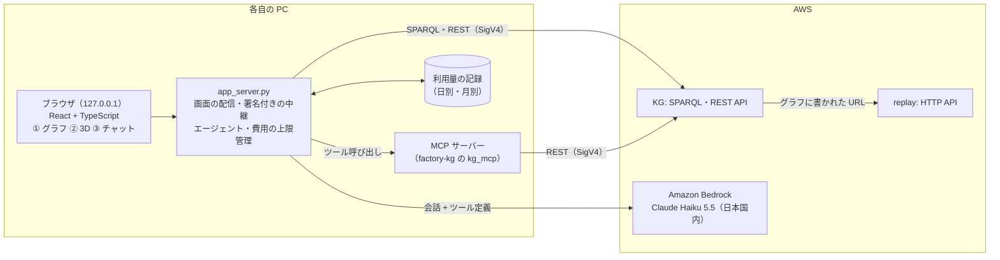

# 工場アプリ 実現方針

[factory-replay](../../factory-replay/)（工場データ）と [factory-kg](../../factory-kg/)（ナレッジグラフ・REST API・MCP）を使う、
3 つの画面を持つアプリケーションを作る。

> 2026-10-24 の回答をすべて反映済み（10 章。方針レベルの未決事項なし）。この方針で実装に入る。

## 1. 要件

| # | 画面 | 内容 |
|---|---|---|
| ① | ナレッジグラフ | 今のローカルビューアのイメージ。工場 → ライン → 設備 → 計測項目 のグラフ、選んだノードの詳細（標準オントロジーのクラス・関係）、最新値と時系列 |
| ② | 工場の 3D ビューア | データを基にした工場の 3D 表示（**可能な範囲でリアルに**）。設備の配置はナレッジグラフから取り、稼働状態や計測値を色・動き・表示で表す |
| ③ | AI エージェント | MCP（factory-kg の MCP サーバー）のツールを使って、工場について日本語の質問に答えるチャット。**費用を明確にし、事故（想定外の請求）が起きない作りにする** |

### 3 つの画面をつなぐ

3 つの画面は **同じ「選択中の設備」と「時刻」を共有する** 1 つのアプリにする。

- ① や ② で設備を選ぶと、もう一方の画面でも同じ設備が選ばれ、右の詳細が切り替わる
- ③ のエージェントが答えに設備を挙げると（例: 「CNC-01 が 14:30 から異常停止」）、① と ② でその設備を強調し、② のカメラがそこへ移動する（決定事項 5）
- ③ の答えには、使ったツール（例: `get_readings`）と取得した値、**その答えにかかった費用（トークン数と円）** を表示する

## 2. 全体構成

各自の PC で動く **小さなサーバー + ブラウザの画面**（決定事項 1）。ブラウザには AWS の認証情報を持たせず、
Bedrock の呼び出し・MCP のツール呼び出し・費用の管理はすべてサーバー側で行う。



| 画面 | データの出どころ | 使う仕組み |
|---|---|---|
| ① ナレッジグラフ | 構造: KG の SPARQL、値: REST API | Cytoscape.js（今のビューアの内容を TypeScript で作り直す） |
| ② 3D ビューア | 配置: ナレッジグラフ（`layout.ttl` を追加）、値: REST API | Three.js（React Three Fiber） |
| ③ AI エージェント | MCP サーバーのツール | Amazon Bedrock の Claude（Converse API）+ MCP クライアント |

## 3. ② 3D ビューア（可能な範囲でリアルに）

### 配置情報はナレッジグラフに入れる（決定事項 3）

- factory-kg に `ontology/layout.ttl`（手書き）を追加し、エリア・ライン・設備ごとに **位置（x, y, z。メートル）・大きさ・向き** を書く
- 語彙は最小限の自前語彙（`xf:position` など）とし、GeoSPARQL（`geo:SpatialObject`）に紐づける
  （SAREF4INMA の生産設備は `geo:SpatialObject` の下位クラスなので自然な拡張）
- SHACL に「設備は配置を持つ」ルールを追加（配置がない設備は警告にし、3D では既定の位置に並べる）
- REST API に配置を返す項目を追加する（`/v1/factory` の各ノードに位置・大きさ・向き）

### リアルにするための方針（外部の有料・ライセンス不明な素材は使わない）

| 対象 | 表現 |
|---|---|
| 建屋 | コンクリート調の床（区画線・安全通路の黄黒ライン）、壁・柱・天井の梁、天井照明。エリア・ラインの名前を床に表示 |
| 設備の形 | 分類ごとに部品を組み合わせて作る（プログラムで生成）。プレス機は本体フレーム・上下するラム・ボルスタ、CNC 加工機は窓付きの筐体と操作盤、コンベアは架台・ローラー・ベルト、コンプレッサは空気タンク・モータ・配管、環境センサは柱に付いた計器箱 |
| 質感 | 金属・塗装・ゴムなどを物理ベースの材質（PBR）で表現。工場らしい塗装色（設備ごとの機械色） |
| 光 | 室内の環境光（Three.js 標準の環境マップ）＋影の出る照明。異常時のランプは発光（ブルーム） |
| **稼働状態** | 各設備に **積層信号灯（緑・黄・赤のシグナルタワー）** を付ける。停止 = 消灯、稼働 = 緑、異常停止 = 赤の点滅。床にも設備の周りに状態の色を薄く表示 |
| 動き（データ連動） | プレス機のラムがショット数に合わせて上下、コンベアのベルトとワークが速度に合わせて流れる、CNC は稼働中に窓の中が光る、コンプレッサは圧力計の針が吐出圧力を指す、環境センサは温度に応じて表示色が変わる |
| 表示 | 設備の上に名前と主な値（例: `CNC-01 主軸負荷 62%`）。選んだ設備は輪郭を強調 |
| 操作 | 回転・拡大・移動、設備をクリックで選択、「全体を見る」「ラインに沿って見る」視点、昼夜の切り替え（夜間・休日は照明を落とす） |
| 将来 | 必要なら CC0（無償・出典表記不要）の 3D モデル（glTF）に差し替えられる作りにする |

- 画質を上げる処理（影・ブルーム・環境光の遮蔽）は、PC の性能に合わせて「標準・高画質」を切り替えられるようにする

### 配置のイメージ（サンプル工場）

```
 ┌──────────────── 製造エリア（約 30m × 15m）──────────────┐
 │  LINE-A                                                    │
 │  [PRESS-01] → [CONV-01 ════════════] → [CNC-01]            │
 │   🚥            🚥                      🚥                  │
 │ ═══════ 安全通路（黄黒） ═════════════════════════════      │
 │  [COMP-01]（壁際・配管つき）        (ENV-01)（中央の柱）    │
 └────────────────────────────────────────────────────────┘
```

## 4. ③ AI エージェントと費用（事故を起こさないために）

### 4.1 Bedrock の料金のしくみ

- Amazon Bedrock の Claude は **使った分だけの従量課金**（入力・出力のトークン数に比例）。**無料枠はない**が、**使わなければ 0 円**（月額の固定費はない）
- 請求は AWS Marketplace の利用料として、AWS の請求書に含まれる
- 単価（東京リージョン、2026-10-24 に AWS Pricing API で確認。1 ドル = 150 円で換算）:

| モデル | 推論プロファイル | 入力（100 万トークン） | 出力（100 万トークン） | 位置づけ |
|---|---|---|---|---|
| **Claude Haiku 5.5** | `jp.`（日本国内） | $0.11（約 17 円） | $0.55（約 83 円） | **既定**。速くて安い |
| Claude Opus 5.5 | `jp.`（日本国内） | $4.40（約 660 円） | $22.00（約 3,300 円） | Haiku の **約 40 倍**。既定では使えなくする |
| Claude Sonnet 5.5 | `global.`（国外を含む） | 東京リージョンの単価なし（国外で処理） | — | 既定では使えなくする |

- プロンプトキャッシュ（繰り返し送る指示・ツール定義を安く読み込む機能）: Haiku 5.5 の読み込みは $0.011（入力の 10 分の 1）。これを使って費用を下げる

### 4.2 1 回の質問の費用の見込み

1 回の質問で、エージェントは「考える → ツールを呼ぶ → 結果を読む」を数回繰り返す。そのたびに会話全体を送るので、入力が膨らむ。

| 想定 | 入力 | 出力 | Haiku 5.5 | （参考）Opus 5.5 |
|---|---|---|---|---|
| 簡単な質問（ツール 1〜2 回） | 約 1 万トークン | 約 500 | **約 0.2 円** | 約 8 円 |
| 普通の質問（ツール 3〜5 回） | 約 3 万トークン | 約 1,500 | **約 0.6 円** | 約 25 円 |
| 上限まで使った場合（ツール 8 回・入力上限） | 約 15 万トークン | 約 8,000 | **約 3 円** | 約 125 円 |

→ Haiku 5.5 なら、**1 日 100 回質問しても数十円** の見込み。実装後に実測して、この表を実測値に置き換える。

### 4.3 事故を防ぐしくみ（何重にも止める）

| 層 | しくみ | 既定値（案） |
|---|---|---|
| 1. モデルを限定 | 使えるモデルはアプリの設定ファイルで許可したものだけ。既定は Haiku 5.5（日本国内）のみ。高いモデルは設定で明示的に許可しない限り選べない | Haiku 5.5（jp）のみ |
| 2. 1 回の質問の上限 | ツール呼び出しの回数、1 回の応答の出力トークン、送る入力トークン（長い会話は古い部分を要約・省略）。上限に達したらそこで止めて、その旨を表示 | ツール 8 回・出力 2,000 トークン・入力 3 万トークン/回 |
| 3. 1 回の質問の費用の上限 | 質問の途中で費用を積算し、上限を超えそうなら次の呼び出しをしない | 5 円/回 |
| 4. 日・月の予算（アプリ内） | Bedrock の応答に含まれる実際のトークン数を記録し、単価で円に換算。**日の予算・月の予算に達したら、その日（月）はエージェントを止める**（①②は使える） | 100 円/日・1,000 円/月 |
| 5. 勝手に動かない | エージェントは質問を送ったときだけ動く（自動実行・定期実行はしない）。実行中は「中止」ボタンで止められる | — |
| 6. 見える化 | 答えごとにトークン数と円、画面上部に今日・今月の累計と残り予算を表示 | — |

- アプリ内の予算（層 4）は **その PC での利用分** を数える（チーム全体の合計の歯止めではない）。
  アカウント側の歯止め（AWS Budgets の通知・予算超過時の自動停止）とオーナー別のコストの見える化（アプリケーション推論プロファイル + タグ）は
  **今回は入れない**（2026-10-24 決定）。必要になったら 9 章の将来の拡張として追加する
- 単価は設定ファイルに持ち、AWS Pricing API から更新できるスクリプトを用意する（単価が変わっても見積もりがずれないように）

### 4.4 エージェントの作り

| 項目 | 案 |
|---|---|
| LLM | Amazon Bedrock の Converse API（ストリーミング）。既定 Claude Haiku 5.5（`jp.anthropic.claude-haiku-5-5`） |
| ツール | factory-kg の MCP サーバーを MCP クライアントとして起動し、ツールの一覧と説明を Bedrock のツール定義に変換して渡す |
| 画面操作のツール | `highlight_equipment(ids)`（①・② で強調し、② のカメラを移動）。画面を変えるだけで、外部への送信・書き込みはしない |
| 指示（システムプロンプト） | MCP サーバーの説明（時刻の扱い・コードの意味）に加え、「値は必ずツールで取る」「分からないことは分からないと答える」「答えは日本語で簡潔に」 |
| 表示 | 答えの逐次表示、使ったツールと結果（折りたたみ）、費用 |
| 会話 | 画面を開いている間だけ覚える（保存しない）。「新しい会話」で消す |

## 5. 画面の作り（TypeScript でかっこいい画面に）

| 部分 | 採用 | 理由 |
|---|---|---|
| ビルド | **Vite + TypeScript** | 速い開発・型による安全性。`npm run build` で静的ファイルにし、`app_server.py` が配信する |
| 画面 | **React** + **Tailwind CSS**（+ Radix UI 系の部品） | 部品が豊富で、整った見た目を作りやすい |
| 3D | **React Three Fiber**（Three.js）+ drei + postprocessing | Three.js を React の部品として書ける。影・ブルームなどの演出がしやすい |
| グラフ | Cytoscape.js（dagre で木構造） | 今のビューアと同じ |
| 時系列 | Apache ECharts | 今のビューアと同じ |
| 状態の共有 | Zustand | 「選択中の設備」「強調中の設備」「時刻」を 3 画面で共有 |
| アイコン | Lucide | MIT ライセンス |

- 見た目は **工場の監視室（オペレーションセンター）風のダークテーマ**。状態の色（緑・黄・赤）が映える配色にし、明るいテーマにも切り替えられる
- 使うライブラリはすべて MIT など商用利用可のライセンス。版はインストール時に固定（`package-lock.json`）
- 開発時は `npm run dev`（画面の変更がすぐ反映）、利用時は `npm run build` 済みの画面を `app_server.py` が配信
- 必要なもの: Node.js 20 以上（この PC は v24 で確認済み）、Python（factory-kg と同じ仮想環境）

画面の構成（イメージ）:

```
┌ 工場アプリ ───── replay: 再生中 62%（CSV 14:52） KG: 900 トリプル  AI: 今日 3.2 円 / 100 円  [更新] ┐
│ [① ナレッジグラフ] [② 3D 工場]                                                                │
│ ┌──────────── 左: ① か ② ─────────────┐ ┌─ 右: 詳細 ─────────┐                │
│ │                                        │ │ CNC 加工機 01  🔴     │                │
│ │    （グラフ または 3D の工場）         │ │ 異常停止（14:30〜）   │                │
│ │                                        │ │ 主軸負荷 0 % …        │                │
│ │                                        │ │ （時系列のグラフ）    │                │
│ └────────────────────────────┘ └───────────────┘                │
│ ┌─ ③ AI エージェント ──────────────────────────────────────────┐   │
│ │ あなた: 14 時台に異常停止した設備は？                                       │   │
│ │ AI: CNC-01 が 14:30 から 9 分間…  ▸ 使ったツール（2）  0.4 円              │   │
│ │ [質問を入力…                                                      ] [送信] │   │
│ └──────────────────────────────────────────────────────┘   │
└────────────────────────────────────────────────────────────┘
```

## 6. 懸念点と対策

| # | 懸念 | 対策・方針 |
|---|---|---|
| A1 | エージェントがもっともらしい誤答をする | 値は必ずツールで取る指示。使ったツールと結果を画面に出す。分からないことは分からないと答える指示 |
| A2 | **想定外の請求** | 4.3 の 6 層（モデル限定・1 回の上限・1 回の費用の上限・日月の予算・自動実行なし・見える化）。アカウント側の歯止めは今回入れないため、アプリの外（別のツール・別の PC）からの利用は数えられない点に注意 |
| A3 | エージェントが値を取り続けて replay の DB が止まらない | ツール呼び出しの上限。自動更新は画面表示中のみ |
| A4 | グラフの文字列などがエージェントへの指示として働く（プロンプトインジェクション） | ツールは読み取り専用、画面操作のツールも強調だけ。画面では文字列として表示 |
| A5 | モデルの利用可否・データの所在 | 実装の最初にモデルアクセスを確認（Anthropic のモデルは初回に利用目的の登録が必要な場合がある）。既定は日本国内のプロファイル。`global.` は既定で使えない |
| A6 | 単価の変更・円換算のずれ | 単価は設定ファイル + 更新スクリプト。円換算のレートも設定にし、画面に「目安」と明記。正確な請求額は AWS の請求で確認 |
| A7 | 3D の配置情報を誰が書くか | サンプル工場分は手書きの `layout.ttl`。配置がない設備は既定の位置に並べて警告 |
| A8 | 3D をリアルにすると重くなる | 画質の切り替え（標準・高画質）。設備はプログラムで作る軽い形。設備数十〜数百台で確認 |
| A9 | 3 画面の連動が複雑になる | 共有する状態（選択・強調・時刻）を 1 か所（Zustand）にまとめる |
| A10 | ビルド環境（Node.js）が増える | 必要なのは開発時と初回だけ（`npm install`・`npm run build`）。作業手順に明記 |
| A11 | ローカルアプリなので URL で共有できない | 将来の Web 化の道を残す（画面はそのまま、サーバーの役割を Lambda に移し、Cognito・CloudFront を足す） |
| A12 | 時刻の分かりにくさ | 画面は「CSV 上の時刻」を主に表示。エージェントにも同じ前提を指示 |

## 7. 費用のまとめ

| 項目 | 目安 |
|---|---|
| アプリ（各自の PC） | 0 円 |
| KG・replay | 今までどおり（使っていない間は月 $0.5 程度。画面表示中は replay の DB が動く） |
| Bedrock（③、Haiku 5.5） | 1 回あたり約 0.2〜3 円。**アプリ内の上限: 5 円/回・100 円/日・1,000 円/月**（どれも設定で変更可） |

## 8. 進め方（案）

| ステップ | 内容 | 完了条件 |
|---|---|---|
| 1 | アプリの土台（Vite + React + TypeScript、`app_server.py`、画面の枠・テーマ・共有の状態）と ① ナレッジグラフ | ① が今のビューアと同等以上に動き、詳細欄が共通になる |
| 2 | 配置情報（`layout.ttl`・SHACL・REST の拡張）と ② 3D ビューア | サンプル工場がリアル寄りの 3D で表示され、信号灯・動き・値の表示・選択の連動が動く |
| 3 | ③ AI エージェント（モデルアクセスの確認 → Bedrock + MCP、費用の管理） | 「CNC-01 の今の状態は？」「14 時台に異常停止した設備は？」に正しく答え、①・② で強調される。上限・予算で確実に止まることをテストで確認 |
| 4 | 仕上げ（作業手順、費用の実測、後片付け） | 作業手順どおりに一通り確認でき、費用の表を実測値に更新 |

## 9. 将来の拡張（今回はスコープ外）

- Web アプリ化（チームで URL を共有）
- CC0 の 3D モデル（glTF）への差し替え、実際の工場図面からの配置の取り込み
- 会話の保存・共有
- アカウント側の費用の歯止め（AWS Budgets の通知・予算超過時の Bedrock 呼び出しの自動停止）、オーナー別のコストの見える化（アプリケーション推論プロファイル + タグ）

## 10. 決定事項（2026-10-24 回答）

| # | 項目 | 決定 |
|---|---|---|
| 1 | アプリの形 | 各自の PC で動くローカルアプリ（一旦これで進める。Web 化は将来） |
| 2 | ③ の LLM | Amazon Bedrock の Claude。**費用を明確にし、事故が起きないようにする**（4 章） |
| 3 | 3D の配置情報 | ナレッジグラフに入れる |
| 4 | 3D の見た目 | **可能な範囲でリアルに**（3 章: 部品を組み合わせた設備、PBR の質感、影・環境光、積層信号灯、データ連動の動き） |
| 5 | エージェントと画面の連携 | 連携する（エージェントが挙げた設備を ①・② で強調） |
| 6 | 画面の作り | **TypeScript でかっこいい画面に**（5 章: Vite + React + Tailwind、監視室風のダークテーマ） |
| 7 | 今のビューア（factory-kg/viewer） | KG 単体の確認用として残し、機能は増やさない |
| 8 | アプリ内の予算の既定値 | 1 回 5 円・1 日 100 円・1 月 1,000 円（設定で変更可） |
| 9 | 使えるモデル | 既定は Claude Haiku 5.5（日本国内）のみ。Opus 5.5（日本国内）は設定で明示的に許可したときだけ。Sonnet 5.5（国外を含む）は使わない |
| 10 | アカウント側の歯止め・オーナー別のコストの見える化 | 今回は入れない（将来の拡張） |

## 11. 開発用のデモモード

AWS の環境（replay・KG）がなくても画面を開発・確認できるよう、`app_server.py --demo` を用意する。
グラフは factory-kg の生成例（`examples/instances.sample.ttl` など）を手元の Oxigraph に読み込み、REST API は factory-kg の `api.dispatch()` を
手元で動かし、replay の値は同梱のサンプル CSV を時刻に合わせて返す（AWS の費用 0 円）。③ のエージェント（Bedrock）はデモモードでも本物を呼ぶ
（費用の上限は同じように効く）。
