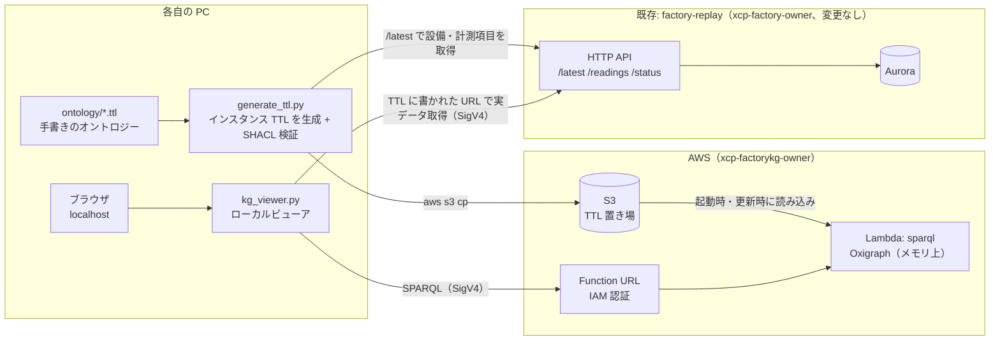
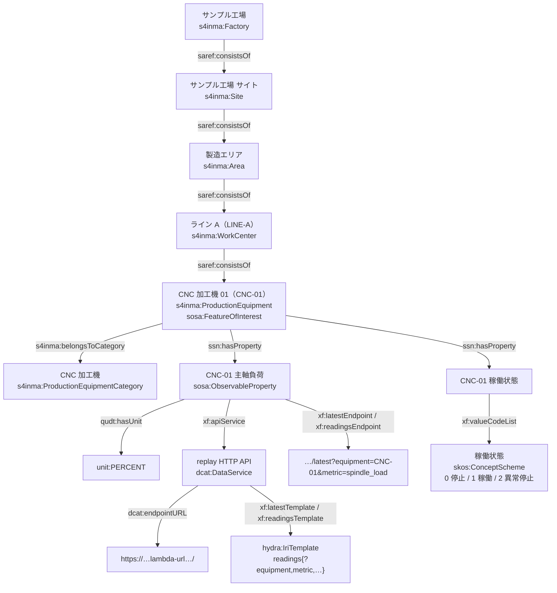

# 工場ナレッジグラフ 実現方針

[factory-replay](../../factory-replay/)（工場 CSV リプレイ基盤）が提供する工場データを、標準オントロジーで整理して
ナレッジグラフにし、画面で表現する仕組みを低コストで作る。

> 2026-10-24: 方針を合意し、ステップ 1〜4 を実装・確認済み。懸念点の対応状況は「7. 懸念点と対策」の最後、確認手順は [作業手順.md](作業手順.md)。

## 1. 要件と決定事項

| # | 要件 | 実現方法 |
|---|---|---|
| ① | 標準的なオントロジーを参照しながら、工場データを取得できる API のエンドポイントを参照させる TTL を作成 | SOSA/SSN・SAREF4INMA・QUDT・DCAT/Hydra・SKOS で工場・ライン・設備・計測項目・単位を表し、各計測項目に replay の HTTP API（`/latest` `/readings`）への参照を持たせる。TTL は手書きのオントロジー部分と、API から自動生成するインスタンス部分に分ける |
| ② | TTL を低コストなナレッジグラフ DB に反映 | TTL を S3 に置き、Lambda 上の RDF ストア（Oxigraph）が読み込んで SPARQL エンドポイントとして公開する（使っていない間はほぼ 0 円） |
| ③ | ナレッジグラフの内容を表現 | 各自の PC で動く **ローカルビューア**（Web アプリにはしない。6 章で比較） |

決定事項（2026-10-24 回答）:

| # | 項目 | 決定 |
|---|---|---|
| 1 | 参照する標準オントロジー | SOSA/SSN（計測）+ SAREF4INMA（工場・設備）+ QUDT（単位）+ DCAT/Hydra（API 参照）+ SKOS（コード表） |
| 2 | グラフに入れる範囲 | **構造のみ**（工場・ライン・設備・計測項目・単位・API 参照）。計測値は入れず、API で取りに行く |
| 3 | ナレッジグラフ DB | S3 + Lambda 上の Oxigraph（読み取り専用）。スケールの考え方と移行の目安は 5 章 |
| 4 | グラフの更新方法 | **TTL の更新で行う**（TTL を作り直して S3 に上げると、DB が読み直す）。DB への直接の書き込み・画面からの編集はしない |
| 5 | 表現方法 | **ローカルビューア**（`kg_viewer.py`）。Cognito・CloudFront・replay の CORS 変更は不要 |
| 6 | 画面の更新 | **手動更新が基本**。自動更新は画面を表示している間だけ |
| 7 | IRI | 仮ドメイン `https://xcp-factory.example/` で始める |
| 8 | 命名 | `xcp-factorykg-<owner>` |
| 9 | イベント（チョコ停など）の表現・グラフの編集 | 今回はスコープ外 |

### 基本方針

- **ナレッジグラフには「構造（メタデータ）」だけを入れ、計測値そのものは入れない。**
  値は今までどおり replay の RDB にあり、グラフには「どこに・どう取りに行けばよいか」（API のエンドポイント）を書く
- 標準の RDF / TTL / SPARQL だけを使い、特定製品に依存しない（規模が大きくなったら Neptune 等へそのまま移せる）
- 既存の factory-replay と同じ流儀（オーナー付きの命名、`setup` / `teardown` の 1 コマンド、使わない間は止まる構成）
- **既存の factory-replay は変更しない**（ローカルビューアなので CORS 追加なども不要）

## 2. 全体構成



ビューアは aws login の認証情報で署名して中継するだけなので、ブラウザは AWS の認証を意識しない
（CLI・`postman_env.py` と同じ考え方）。

## 3. ① オントロジーと TTL

### 参照する標準オントロジー（決定）

| 語彙 | 名前空間 | 使う部分 | 役割 |
|---|---|---|---|
| **SOSA / SSN**（W3C 勧告） | `http://www.w3.org/ns/sosa/`、`http://www.w3.org/ns/ssn/` | `sosa:Platform`（設備）、`sosa:ObservableProperty`（計測項目）、`ssn:isPropertyOf` | 計測項目 |
| **SAREF4INMA**（ETSI、SAREF の製造業拡張） | `https://saref.etsi.org/saref4inma/` | `s4inma:Factory`、`s4inma:ProductionEquipment` など | 工場・設備の分類（ISA-95 の階層に沿う） |
| **QUDT** | `http://qudt.org/schema/qudt/`、`http://qudt.org/vocab/unit/` | `qudt:hasUnit unit:MegaPA` など | 単位 |
| **DCAT**（W3C 勧告） | `http://www.w3.org/ns/dcat#` | `dcat:DataService`、`dcat:endpointURL` | replay の HTTP API |
| **Hydra Core** | `http://www.w3.org/ns/hydra/core#` | `hydra:IriTemplate`、`hydra:mapping` | API の URL テンプレートとパラメータ |
| **SKOS** | `http://www.w3.org/2004/02/skos/core#` | 稼働状態コード（0=停止 1=稼働 2=異常停止） | コード表 |
| RDFS / DCTERMS / PROV-O | — | ラベル（日本語・英語）、作成日時、生成元 | 説明・来歴 |

- 役割が重なる部分（SOSA と SAREF はどちらも「計測」を持つ）は、上の「役割」の列で使い分けを固定する
- 標準にない概念（「生産ライン」「設備 ID」「API 上のメトリクス名」など）は自前の拡張語彙 `xf:` に定義し、`rdfs:subClassOf` などで標準に紐づける

### モデル（ステップ 1 で確定）

SAREF4INMA v2.1.1 が IEC 62264（ISA-95）の階層（工場 → サイト → エリア → ワークセンタ）を持っていたため、
「ライン」は自前のクラスを作らず `s4inma:WorkCenter` を使う（懸念点 O3 が解消）。親子関係はすべて `saref:consistsOf`。



- コンプレッサ・環境センサは製品を作らないので `s4inma:ProductionEquipment` ではなく `saref:Device`（ProductionEquipment は saref:Device の下位クラス）
- 使い分けの一覧は [ontology/README.md](../ontology/README.md)

### 生成される TTL（抜粋。`examples/instances.sample.ttl`）

```turtle
<https://xcp-factory.example/id/line/LINE-A> a s4inma:WorkCenter ;
    rdfs:label "Line A"@en, "ライン A"@ja ;
    saref:consistsOf <https://xcp-factory.example/id/equipment/CNC-01>, ... ;
    xf:lineId "LINE-A" .

<https://xcp-factory.example/id/equipment/CNC-01> a sosa:FeatureOfInterest, s4inma:ProductionEquipment ;
    rdfs:label "CNC machining center 01"@en, "CNC 加工機 01"@ja ;
    s4inma:belongsToCategory <https://xcp-factory.example/id/category/cnc> ;
    ssn:hasProperty <https://xcp-factory.example/id/property/CNC-01/spindle_load>, ... ;
    xf:equipmentId "CNC-01" .

<https://xcp-factory.example/id/property/CNC-01/spindle_load> a sosa:ObservableProperty ;
    rdfs:label "CNC-01 spindle load"@en, "CNC-01 主軸負荷"@ja ;
    rdfs:comment "主軸モータの負荷率"@ja ;
    ssn:isPropertyOf <https://xcp-factory.example/id/equipment/CNC-01> ;
    qudt:hasUnit unit:PERCENT ;
    xf:metricName "spindle_load" ;
    xf:apiService <https://xcp-factory.example/id/service/replay-api> ;
    xf:latestEndpoint <https://xxxxxxxx.lambda-url.ap-northeast-1.on.aws/latest?equipment=CNC-01&metric=spindle_load> ;
    xf:readingsEndpoint <https://xxxxxxxx.lambda-url.ap-northeast-1.on.aws/readings?equipment=CNC-01&metric=spindle_load> .

<https://xcp-factory.example/id/service/replay-api> a dcat:DataService ;
    rdfs:label "工場 CSV リプレイ HTTP API"@ja ;
    dcat:endpointURL <https://xxxxxxxx.lambda-url.ap-northeast-1.on.aws/> ;    # replay スタックから自動で埋める
    xf:latestTemplate <.../template/latest> ;      # hydra:template "latest{?equipment,metric}"
    xf:readingsTemplate <.../template/readings> .  # hydra:template "readings{?equipment,metric,minutes,from,to,source_from,source_to,limit,next}"
```

- **エンドポイントの持たせ方**: API の URL は `dcat:endpointURL` の 1 か所に持ち、各計測項目にはそれを展開した完成形の URL も併記する。
  両者の食い違い（URL の更新漏れ）は SHACL で検出する
- **ファイル構成**: 手書きは `ontology/xf.ttl`（拡張語彙）・`codes.ttl`（コード表・設備の分類）・`labels-ja.ttl`（標準の語の日本語ラベル）・`shapes.ttl`（SHACL）。
  生成は `ontology/imports.ttl`・`units.ttl`（標準語彙からの抜粋、`tools/vocab.py`）と `build/instances.ttl`（`tools/generate_ttl.py`）
- **生成の流れ**: `generate_ttl.py` が replay の `/latest`（または CSV）から「ライン・設備・メトリクス・単位」の組を取り、
  カタログ（設備の種類・計測項目・単位の対応表）で TTL にする。カタログにないものはエラー（O4）。SHACL で検証してから使う
- **規模（実測）**: 1 ライン（5 設備・15 計測項目）≒ 200 トリプル。26 ライン（設備 130・計測項目 390）で 5,277 トリプル、
  オントロジー込み 5,890 トリプルを Oxigraph に 13 ms で読み込めた

## 4. ② ナレッジグラフ DB

### 比較（東京リージョン。Neptune は 2026-10 に Pricing API で確認した単価）

| 案 | 月額の目安 | 長所 | 短所 |
|---|---|---|---|
| **A. S3（TTL）+ Lambda 上の Oxigraph（メモリ上）+ Function URL**（決定） | **ほぼ 0 円**（Lambda の実行分のみ。無料枠内） | 標準 SPARQL 1.1 が使える。使わない間は課金なし。`pyoxigraph` は Lambda（arm64）用の配布物あり（0.5.1 で確認） | 読み取り専用（更新は TTL の再アップロード）。起動のたびに TTL を読み込む |
| B. Neptune Serverless | 最小容量が常時課金: $0.1941 / NCU 時 × 1 NCU × 730 時間 ≒ **月 $140〜** | マネージド、SPARQL・更新・大規模に対応 | 0 まで縮退しない。VPC 内のみで、Lambda も VPC に入れる必要あり |
| C. Neptune（db.t4g.medium） | $0.1424 / 時 ≒ **月 $104**（停止は最大 7 日） | 同上 | 使わなくても課金 |
| D. Neptune Analytics | 最小 16 m-NCU: $0.581 / 時 ≒ **月 $420〜** | グラフ分析アルゴリズム | 今回の規模には過剰 |
| E. Apache Jena Fuseki on ECS Fargate | Fargate 最小構成で月 $10 前後 + 公開のための ALB 等（月 $20〜） | 定番の OSS トリプルストア、更新も可 | 常時起動。コンテナの運用が増える |
| F. 既存 Aurora にトリプル表を作る | 追加 0 円 | 新サービス不要 | SPARQL が使えない（SQL で自作）。グラフ DB ではない |

### A の詳細

- `publish_ttl.py` が SHACL 検証に通ったグラフを、名前付きグラフごと **1 つの N-Quads（`kg/current.nq`）** にまとめて S3 に上げる。
  1 ファイルなので、Lambda から見て「一部のファイルだけ新しい」状態にならない（ステップ 2 で確定）
- `sparql` Lambda（Python 3.13・arm64・512 MB）が、コールドスタート時に `kg/current.nq` を読み込んで Oxigraph のメモリ上ストアを作る。
  pyoxigraph は `manylinux_2_28_aarch64` の配布物を zip に同梱する（0.5.2 以降は `manylinux2014` の arm64 版がない。Lambda の python3.13 は Amazon Linux 2023・glibc 2.34 なので使える）
- エンドポイント: `GET/POST /sparql`（SPARQL 1.1 Protocol。結果は JSON / XML / CSV / TSV、CONSTRUCT は Turtle / N-Triples）、`GET /status`（トリプル数・名前付きグラフ・ETag・読み込み時間。`?reload=1` で即読み直し）
- 公開する操作は **SPARQL 1.1 Query のみ**。Update は 403、Update 構文を Query として送った場合は 400（Oxigraph の Query の解析器が受け付けないので、誤って更新されることはない）
- TTL を更新したら、Lambda が S3 の ETag を 30 秒ごとに確認して読み直す。`publish_ttl.py` は公開後に `/status?reload=1` で新しい版が使われていることまで確かめる
- 名前付きグラフで「オントロジー」「インスタンス」「単位・コード表」を分けて入れ、出どころを区別できるようにする
- 推論（OWL reasoning）はしない。上位クラスでの検索は SPARQL のプロパティパス（`rdf:type/rdfs:subClassOf*`）で書く
- 重いクエリへの備え: Lambda のタイムアウト（30 秒）が実行時間の上限。応答が 5.5 MB を超えたら 413 で `LIMIT` を促す

### グラフの更新（決定事項 4: TTL の更新で行う）

DB は TTL を読み込むだけなので、**グラフの正本は TTL（Git の `ontology/` と S3 の TTL）**。更新はすべて次の流れで行う。

| 変えたいもの | 手順 |
|---|---|
| 設備・計測項目の増減（CSV のライン数を変えた等） | replay に新しい CSV を流す → `generate_ttl.py` で `instances.ttl` を再生成 → SHACL 検証 → S3 へアップロード |
| 名前・分類・単位の対応、自前語彙の定義 | `ontology/*.ttl` や生成スクリプトの対応表を直して Git にコミット → 再生成 → SHACL 検証 → S3 へアップロード |
| replay の API の URL（replay を作り直した） | `setup` を再実行（replay スタックの出力から URL を埋めて再生成・アップロード） |

- アップロードは「SHACL 検証に通ったら S3 に上げる」までを 1 コマンドにする（`publish_ttl.py`。検証に失敗したら上げない）
- S3 はバージョニングを有効にし、壊れた TTL を上げてしまったら 1 つ前に戻せるようにする
- DB（Lambda）は S3 の更新を数十秒以内に検知して読み直す。ビューアは「更新」ボタンで最新のグラフを取り直す

## 5. スケールの考え方（決定事項 3 への補足）

「スケール」を 3 つに分けると、A は **「リクエスト数」と「データ量（ある程度まで）」には強く、「更新」には弱い**。

| 観点 | A での振る舞い | 目安 | 限界を超えたら |
|---|---|---|---|
| リクエスト数（同時に使う人数） | Lambda がインスタンスを自動で増やす。各インスタンスが独立に TTL を読むので、互いに影響しない | チーム利用（数人〜数十人）なら余裕。上限は AWS アカウントの Lambda 同時実行数（多くのアカウントで既定 1,000。作成直後のアカウントでは小さいことがある。共有アカウントでは他の人と共用） | 読み込み済みのインスタンスを使い回すので、増えても費用は実行時間に比例するだけ |
| データ量（トリプル数） | すべてメモリに載せる。Lambda のメモリは最大 10 GB。**実測（ステップ 2）: 下の表**。N-Quads は 100 万トリプルで約 216 MB になり、512 MB の Lambda には載らない | 構造だけなら「1 ライン（5 設備・15 計測項目）≒ 200 トリプル」（ステップ 1 で実測）で、**ライン 1,000 本でも 20 万トリプル規模**。数十万トリプルまでは問題ない想定 | 起動時の読み込みが遅くなる（数百万トリプルで数秒〜十数秒の可能性。**ステップ 2 で実測する**）。対策の順: ①事前に変換した Oxigraph のデータファイルを S3 から取得して開く（解析が不要になる）、②メモリを増やす、③ B（Neptune）/ E（Fuseki）へ移す |
| 更新（書き込み） | できない。TTL を差し替えて読み直すだけ | 「生成して表示する」用途なら問題なし。差し替えは数十秒以内に反映 | 画面からの編集、頻繁な部分更新、複数人の同時編集が必要になったら B / E へ移す |

読み込み時間の実測（2026-10-24。本物のインスタンスを IRI を変えて複製した合成グラフ。`tools/bench_load.py`）:

| トリプル数 | N-Quads | PC | Lambda 512 MB | Lambda 2048 MB | Lambda 2048 MB（S3 からの取得込み） |
|---|---|---|---|---|---|
| 900（今のグラフ） | 0.2 MB | 2 ms | 20 ms | — | — |
| 1 万 | 2.1 MB | 21 ms | 98 ms | — | — |
| 10 万 | 21 MB | 227 ms | 1.3 秒 | 0.4 秒 | 1.9 秒 |
| 100 万 | 216 MB | 2.6 秒 | （メモリ不足） | 4.6 秒 | 8.5 秒 |

- Lambda はメモリに比例して CPU が増えるので、大きいグラフはメモリを増やすと速くなる（10 万トリプルで 512 MB → 2048 MB にすると約 3 倍）
- 100 万トリプルではコールドスタートが 8.5 秒になり、移行の目安（5 秒）を超える。それまでの対策の候補: N-Quads を圧縮して置く（取得時間を短縮）、
  Oxigraph のデータファイルを事前に作って置く（解析を省く）
- 今の規模（900 トリプル、ライン 1,000 本でも約 20 万トリプル）なら 512 MB で十分

- **計測値をグラフに入れない方針（決定事項 2）が、スケールの一番の前提**。計測値まで入れると、1 日分で 2 万件・1 か月で数百万件の観測になり、A では持たない
- 移行時は TTL（正本）と SPARQL（クエリ）をそのまま使える。変わるのはストアの置き場所と接続先だけ
- 移行の判断目安: 「トリプル数 100 万超」「起動時の読み込み 5 秒超」「更新が必要」のいずれか

## 6. ③ 表現方法の比較

| 案 | 構成 | 費用 | 長所 | 短所 |
|---|---|---|---|---|
| **a. ローカルビューア**（決定） | `kg_viewer.py` が localhost で画面（HTML + Cytoscape.js / ECharts）を配信し、SPARQL と replay API への要求を aws login の認証情報で署名して中継する | **0 円** | Cognito・CloudFront・**replay の CORS 変更が不要**。認証は CLI と同じ（各自の aws login）。URL や認証情報の貼り替えも不要 | 各自が Python と aws login を用意して起動する。URL で人に共有できない |
| b. Web アプリ（当初案） | S3 + CloudFront で配信、Cognito でログイン、ブラウザが SigV4 署名して直接呼ぶ | ほぼ 0 円 | URL を開くだけで使える。AWS アカウントのない人にも見せられる | Cognito のユーザー管理、CloudFront、**replay の Function URL に CORS 追加**が必要。構成・運用が一番重い |
| c. Jupyter Notebook | `rdflib` / `SPARQLWrapper` 相当で SPARQL を投げ、`ipycytoscape` などで描画。値は CLI と同じ方法で取得 | 0 円 | 分析・試行錯誤に向く。コードで自由に加工できる | 画面としての完成度は低い。Notebook 環境の用意が必要 |
| d. 既存ツールで見る | Postman で SPARQL（コレクションを追加）、TTL を Protégé（OntoGraf）や GraphDB Free などのデスクトップツールで開く | 0 円 | 作るものが最小 | 実データ（最新値・時系列）との連携はできない。ツールごとに操作を覚える必要あり |

→ **a に決定**。「整理されたナレッジグラフの内容を表現する」目的には十分で、追加の AWS 構成も既存システムの変更も要らない。
画面の中身（グラフ・詳細・実データ）は b と同じものを localhost で出すだけなので、**後から b（Web アプリ化）に移すのも容易**（署名を中継からブラウザ側に移すだけ）。
c・d は a と併用できる（例: d の Postman コレクションに SPARQL のリクエストを追加して確認用に使う）。

### a の画面のイメージ

| 領域 | 内容 | データの出どころ |
|---|---|---|
| 上部 | リプレイの状態（`running` / `done`、進捗、CSV 上の現在時刻） | replay `/status` |
| 左: グラフ | 工場 → ライン → 設備 → 計測項目 の階層グラフ。種類ごとに色分け。設備は稼働状態（稼働 / 停止 / 異常停止）で縁の色を変える | KG（SPARQL）+ replay `/latest` |
| 右: 詳細 | 選んだノードの日本語名・種類（標準オントロジーのクラスへのリンク）・関係。計測項目なら最新値・単位・直近の時系列グラフ | KG（SPARQL）+ TTL に書かれたエンドポイント（`/latest`、`/readings`） |
| 補助 | 検索（設備 ID・名前）、絞り込み（ライン・設備種別）、SPARQL を直接書ける欄 | KG（SPARQL） |

- 起動: `python tools/kg_viewer.py --owner <owner>` → ブラウザで `http://127.0.0.1:8765/` が開く
- 実装（ステップ 3 で確定）: サーバーは Python 標準ライブラリのみ。画面は HTML + JavaScript（ビルド不要）で、Cytoscape.js（グラフ、dagre で木構造に配置）と
  ECharts（時系列）を cdn.jsdelivr.net から版を固定して読み込む（インターネット接続が必要）。画面が使う SPARQL は `viewer/queries/*.rq`（テストでも同じものを実行）
- 中継の制限（V2）: 待ち受けは 127.0.0.1 のみ、Host ヘッダーが localhost 以外は拒否（DNS リバインディング対策）、API には独自ヘッダー必須（他のサイトからの悪用対策）。
  replay への中継は、グラフの `dcat:endpointURL` で始まる `latest` / `readings` / `status` だけ（リセットなどは中継しない）
- `#q=CNC-01` のような URL で、その設備・計測項目を選んだ状態で開ける（ブックマーク用）
- 中継するのは「KG の SPARQL」と「TTL に書かれた replay API の URL」だけ（任意の URL への中継はしない）
- 画面の更新（決定事項 6）:
  - 基本は「更新」ボタン（グラフ・最新値・時系列・リプレイ状態を取り直す）
  - 自動更新（1 分ごと）は **画面を表示している間だけ**動かす。タブを切り替える・最小化するなど画面が見えなくなったら止め、戻ったら再開する
  - 自動更新の対象は replay の実データ（`/status` `/latest` と表示中の時系列）だけ。グラフ（TTL）は更新ボタンで取り直す

## 7. 懸念点と対策

### オントロジー・モデリング

| # | 懸念 | 影響 | 対策・方針 |
|---|---|---|---|
| O1 | 標準オントロジーが複数あり、役割が重なる（SOSA と SAREF はどちらも「デバイス」「計測」を持つ） | 同じものを 2 通りに書いて検索が漏れる | 役割分担を固定する（3 章の表）。`ontology/README` に明記し、SHACL で強制する |
| O2 | 標準のクラス名・プロパティ名の思い込み | 存在しない IRI を書いてしまう | 実装時に各オントロジーの公式 TTL を取得し、使う IRI が実在するかをスクリプトで検査する |
| O3 | 「生産ライン」など、標準に素直な対応物がない概念 | 自前語彙が増え、標準を参照する意味が薄れる | 自前語彙は最小限にし、必ず `rdfs:subClassOf` / `rdfs:subPropertyOf` で標準に紐づける |
| O4 | 単位の対応（`count`、`%`、`rpm`、`m/min` など） | 誤った単位 IRI | 対応表を固定する（例: `MPa`→`unit:MegaPA`、`degC`→`unit:DEG_C`、`kW`→`unit:KiloW`、`rpm`→`unit:REV-PER-MIN`、`%`→`unit:PERCENT`、`count`→`unit:NUM`、`ppm`→`unit:PPM`）。O2 と同じく実在を検査し、未知の単位は生成時にエラーにする |
| O5 | 稼働状態（0/1/2）や「間隔内のショット数」など、値の意味がコードや約束ごと | グラフだけ見ても意味が分からない | コードは SKOS のコード表に、値の意味は計測項目の説明（`rdfs:comment`）に書く |
| O6 | 外部オントロジーを丸ごと取り込むと巨大（QUDT は数十万トリプル規模） | メモリ・起動時間の増加 | 使う語だけを抜粋して取り込み、他は IRI で参照するだけにする |
| O7 | 推論しない（Oxigraph に推論機能はない） | 上位クラスで検索すると漏れる | SPARQL を `rdfs:subClassOf*` で書く。必要になれば生成時に推論結果を書き出す |
| O8 | IRI が仮ドメイン（`https://xcp-factory.example/`） | 正式運用時に全データの書き換えが必要 | IRI のベースは生成スクリプトの設定 1 か所にし、変更時は再生成で済むようにする。`example` ドメインは外部と衝突しない（予約済み） |

### TTL と API エンドポイントの参照

| # | 懸念 | 影響 | 対策・方針 |
|---|---|---|---|
| T1 | replay の Function URL はスタックを作り直すと変わる | TTL の参照が切れる | URL は `id:ReplayApi` の 1 か所に集約し、`setup` 時に replay スタックの出力から自動で埋めて再生成する |
| T2 | replay の API は IAM 認証 | TTL に URL があっても、署名なしでは呼べない | ビューアが aws login の認証情報で署名して中継する（将来 b に移す場合は Cognito + CORS 追加が必要） |
| T3 | TTL 生成時に replay のデータが必要（`/latest` は直近のデータから設備を拾う） | replay が空・一時停止中だと生成できない／一部しか拾えない | 生成前に `/status` を確認し、`total_rows = 0` ならエラーにする。DB 再開待ち（503）はリトライ |
| T4 | API の仕様変更（パラメータ名など）にグラフが追随しない | テンプレートが古くなる | テンプレートは生成スクリプトの 1 か所で定義し、replay 側の変更時に一緒に直す。将来は replay に OpenAPI 定義を置き、`dcat:endpointDescription` で参照する |
| T5 | TTL の品質（必須の関係が抜ける・型の誤り） | 画面が壊れる・検索漏れ | SHACL で検証してから S3 に上げる（検証に通らなければアップロードしない） |

### ナレッジグラフ DB（Lambda + Oxigraph）

| # | 懸念 | 影響 | 対策・方針 |
|---|---|---|---|
| G1 | コールドスタート時の TTL 読み込み時間 | 初回表示が遅い | ステップ 2 で実測する（数千・10 万・100 万トリプルの TTL を生成して比較）。遅ければ 5 章の対策 |
| G2 | Lambda の複数インスタンス間で TTL 更新の反映がずれる | 更新直後、古い内容が見えることがある | ETag 確認の間隔（数十秒）以内に揃う、と割り切る |
| G3 | 書き込みできない | グラフを編集できない | 更新は TTL の差し替えで行う（決定事項 4）。画面からの編集は今回スコープ外（決定事項 9）。必要になったら B / E へ移行 |
| G4 | 重い SPARQL（全件の組み合わせなど） | Lambda の課金・タイムアウト | 実行時間と件数の上限、Function URL の IAM 認証で利用者を限定 |
| G5 | `pyoxigraph` の Lambda 上での動作 | 配布物はあるが、未検証 | ステップ 2 の最初に小さな TTL で動作確認する |
| G6 | 共有アカウントの Lambda 同時実行数（既定 1,000）を他の人と共用 | 大量アクセス時に他の人の Lambda が詰まる | チーム利用の規模では問題にならない想定。予約同時実行は設定しない（共有の枠を減らすため） |

### 表現（ローカルビューア）

| # | 懸念 | 影響 | 対策・方針 |
|---|---|---|---|
| V1 | 各自の PC での起動が必要 | Python・aws login の準備が要る | factory-replay と同じ venv・aws login を使う（追加の準備はほぼなし） |
| V2 | ビューアが署名付きの中継をする | 任意の URL を中継すると、ローカルの認証情報で何でも呼べてしまう | 中継先は「KG の SPARQL」と「TTL に書かれた replay API の URL（ホストが一致するもの）」に限定。待ち受けは `127.0.0.1` のみ |
| V3 | TTL のラベルなどを画面に出す | 不正な文字列による XSS | 画面ではテキストとしてだけ表示し、HTML として解釈しない |
| V4 | グラフのノードが増えると見づらい・重い | 操作性の低下 | 初期表示は工場〜設備まで、計測項目はクリックで展開。ライン・設備種別で絞り込み |
| V5 | オントロジーに不慣れな人には分かりにくい | 使われない | 表示は日本語ラベル中心にし、IRI やクラス名は詳細欄の補足にとどめる |
| V6 | 時刻 | 誤解 | replay の API は日本時間で返す。画面も日本時間で統一し、「反映時刻」と「CSV 上の時刻」を区別して表示する |
| V7 | 将来 URL で共有したくなった場合 | a のままでは共有できない | b へ移す（画面はそのまま、署名をブラウザ側へ移し、Cognito と replay の CORS 追加を行う） |

### コスト・運用

| # | 懸念 | 影響 | 対策・方針 |
|---|---|---|---|
| C1 | **ビューアを表示したまま放置すると、自動更新が replay の Aurora を起こし続ける** | 画面を表示し続けた時間だけ Aurora が動く（最大で 0.5 ACU × 24 時間 × 30 日 ≒ 月 $54） | 自動更新は画面を表示している間だけ（決定事項 6）。使い終わったらビューアを閉じることを作業手順に書く |
| C2 | 共有アカウントでの名前の衝突 | 他の人の環境を壊す | スタック名・リソース名は `xcp-factorykg-<owner>`（決定）。`xcp-factory-<owner>-…` にしないのは、replay の `teardown` の残存確認が `xcp-factory-<owner>-` で始まるログ等を自分のものとして数えてしまうため |
| C3 | replay スタックへの依存 | replay を消すと実データが見えない | グラフ表示は replay がなくても動き、実データの欄だけ「取得できません」と表示する。`setup` は replay スタックの出力を読んでパラメータで渡す（CloudFormation の Export は使わない。結合が強くなり、replay を消せなくなるため） |
| C4 | 片付け忘れ | 少額だが課金が続く | replay と同じく `teardown` で削除し、残存リソースを自動確認する |
| C5 | 外部オントロジーの利用条件 | ライセンス違反 | SOSA/SSN・DCAT（W3C）、SAREF（ETSI）、QUDT（CC BY 4.0）。抜粋して同梱する場合は出典を明記する |

### 対応状況（2026-10-24、ステップ 4 完了時点）

| 状況 | 懸念点 |
|---|---|
| **対応済み（実装・テストで確認）** | O1 使い分けを `ontology/README.md` に固定し、SHACL で型を検査／O2 `vocab.py` が使っている 51 個の IRI の実在を公式の定義で検査／O3 ラインは標準の `s4inma:WorkCenter`（自前のクラスなし）／O4 単位の対応表、未知の単位は生成時にエラー／O5 SKOS のコード表と `rdfs:comment`／O6 標準語彙は抜粋のみ（単位は 8.7 万 → 267 トリプル）／O7 上位クラスを `imports.ttl` に取り込み `rdfs:subClassOf*` で検索（クエリ 04）／T1 `setup_aws.py` が replay の URL でグラフを作り直す + SHACL で URL の食い違いを検出／T2 ビューアが署名して中継／T5 SHACL に通らなければ公開しない／G1 読み込み時間を実測（5 章）／G4 タイムアウト 30 秒・応答 5.5 MB 超は 413／G5 Lambda（arm64）で動作確認（`manylinux_2_28` の配布物）／G6 予約同時実行なし／V2 中継先を限定（テストで確認）／V3 画面は textContent のみ、IRI の検査／V5 日本語ラベル中心（標準の語にも日本語ラベル）／V6 日本時間、反映時刻と CSV 上の時刻を区別／C2 `xcp-factorykg-<owner>`（replay の残存確認に数えられないことを確認）／C3 replay がなくてもグラフは表示、Export を使わない／C4 `teardown_aws.py` が残存リソースを確認／C5 抜粋ファイルに出典・利用条件を記載 |
| **一部対応・運用で注意** | O8 IRI のベースは `kgcommon.py` の `BASE` と手書きの TTL の接頭辞（変えるときは両方）／T3 replay が空・DB 再開中（503）は再実行で対応（自動リトライはしない）／G2 publish 直後、別の Lambda インスタンスは最大 30 秒古いグラフを返しうる／V1 KG 用に別の仮想環境が必要／V4 1 ラインでは確認済み、数十ライン規模の見た目は未確認（絞り込み・展開で対処する想定）／C1 自動更新は表示中のみだが、表示したまま放置すると replay の DB が止まらない（作業手順に明記） |
| **スコープ外・将来** | G3・決定事項 9 グラフの編集、イベント（チョコ停など）の表現／T4 replay の OpenAPI 定義と `dcat:endpointDescription`／V7 URL で共有できる Web アプリ化（10 章） |

## 8. コスト目安

| 項目 | 想定 | 月額の目安 |
|---|---|---|
| Lambda（sparql） | 1 回数百 ms × 数千回 | 無料枠内 |
| S3（TTL） | 数 MB | ほぼ 0 円 |
| ローカルビューア | 各自の PC | 0 円 |
| replay 側（Aurora） | ビューアから API を呼んでいる間だけ動く | 使い方次第（C1 参照） |
| **合計（KG 側）** | | **ほぼ 0 円** |

比較: グラフ DB を Neptune にすると、それだけで月 $100〜140 以上（4 章）。

## 9. 進め方と状況

| ステップ | 内容 | 完了条件 | 状況 |
|---|---|---|---|
| 1 | オントロジー設計（`ontology/*.ttl`、SHACL）、使う IRI の実在検査、`generate_ttl.py`、ローカルでの SPARQL 確認 | replay の API から TTL が生成され、SHACL 検証に通り、代表的な SPARQL（ライン A の設備と計測項目・単位・API 参照の一覧など）が期待どおり返る | 完了（b009972。CSV・replay の API の両方から生成。TTL に書いた URL・テンプレートで replay の実データを取得できることを確認） |
| 2 | KG ストア（S3 + `sparql` Lambda + Function URL）と `setup` / `teardown`。読み込み時間の実測（5 章） | CLI / Postman から SPARQL で取得でき、TTL を差し替えると反映される。署名なしは 403。トリプル数ごとの起動時間を記録 | 完了（AWS 上で CLI の結果がローカルと一致、更新・ロールバック・不正な TTL の拒否、更新要求の拒否、署名なし 403 を確認。読み込み時間を実測。6a2fae7） |
| 3 | ローカルビューア（グラフ表示・詳細表示・実データ連携） | 工場〜計測項目のグラフが出て、計測項目を選ぶと最新値と時系列が表示される | 完了（AWS の KG・replay につないで画面を確認。13a9c03） |
| 4 | 仕上げ（自動更新の制御、検索・絞り込み、ドキュメント、後片付けの確認） | 作業手順書どおりに一通り確認でき、`teardown` で何も残らない | 完了（作業手順を一本化、懸念点の対応状況を整理、後片付けの確認） |

## 10. 今後の拡張の候補（今回はスコープ外）

| 候補 | 内容 | 関連 |
|---|---|---|
| イベントの表現 | replay のデータから「チョコ停」「エア漏れ」などを検出し、イベントとしてグラフに追加する（時刻・設備・種類） | 決定事項 9 |
| URL で共有できる Web アプリ | 画面はそのまま、署名をブラウザ側へ移し、Cognito（ログイン）と replay の Function URL への CORS 追加を行う | 6 章 b、V7 |
| replay の API 定義 | replay に OpenAPI 定義を置き、`dcat:endpointDescription` で参照する（テンプレートの変数も定義から作る） | T4 |
| 大きいグラフへの対応 | N-Quads の圧縮、Oxigraph のデータファイルの事前作成、移行の目安を超えたら Neptune / Fuseki へ（TTL・SPARQL はそのまま） | 5 章 |
| ビューアのオフライン利用 | 画面のライブラリ（Cytoscape.js・ECharts・dagre）をリポジトリに同梱し、インターネットなしで使えるようにする | 6 章 a |
