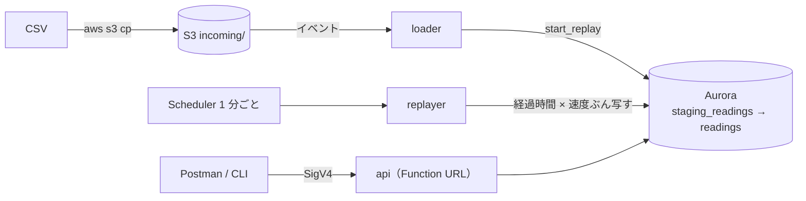

# factory-replay

工場ラインのサンプルデータ（CSV）を S3 にアップロードすると RDB（Aurora PostgreSQL）に少しずつ反映され、
HTTP API で取得・リセットできる検証用キット。低コスト優先で、使っていない間は DB が自動で一時停止する。

- 方針・設計: [docs/実現方針.md](../docs/実現方針.md)
- AWS での確認手順（作成から片付けまで）: [docs/作業手順.md](../docs/作業手順.md)



## クイックスタート

前提: Python 3.10 以上、AWS CLI v2、東京リージョン。PowerShell で `factory-replay` フォルダから実行する。

```powershell
python -m venv .venv                                   # 初回のみ
.\.venv\Scripts\Activate.ps1                           # ターミナルを開くたび
pip install -r requirements.txt                        # 初回のみ
aws login

python aws/setup_aws.py --owner <owner>                # 環境を作成（初回 10〜15 分）。再実行で更新
aws s3 cp data/factory_sample.csv s3://xcp-factory-<owner>-data-<アカウントID>/incoming/   # ② 反映開始
python tools/cli.py --owner <owner> status             # ③ 進み具合
python tools/cli.py --owner <owner> reset --speed 720  # ④ 720 倍速で最初から
python aws/teardown_aws.py --owner <owner>             # すべて削除
```

`--owner` は英小文字で始まる英小文字・数字 2〜16 文字。共有アカウントで他の人と衝突しないよう、
すべてのリソース名が `xcp-factory-<owner>` から作られる。

## ファイル構成

```
factory-replay/
├── data/factory_sample.csv           ① 同梱サンプル（1 日分）
├── tools/
│   ├── generate_csv.py               ① サンプル CSV の生成
│   ├── cli.py                        ③ 取得 / ④ リセット（HTTP API を署名付きで呼ぶ）
│   ├── apiclient.py                  HTTP API 呼び出しの共通処理
│   └── postman_env.py                Postman の Environment（URL・認証情報）を作る
├── postman/xcp-factory.postman_collection.json   Postman コレクション
├── aws/
│   ├── template.yaml                 CloudFormation（VPC / S3 / Aurora / Lambda / Function URL / Scheduler / IAM）
│   ├── schema.sql                    テーブルと DB 関数（start_replay / reset_replay）
│   ├── lambda/                       loader / replayer / api / schedule
│   ├── dataapi.py                    Data API 共通処理（Lambda にも同梱）
│   ├── naming.py                     命名ルール
│   ├── setup_aws.py                  作成・更新（Lambda コードのアップロード + デプロイ + スキーマ作成）
│   └── teardown_aws.py               削除
└── requirements.txt                  boto3[crt]（aws login の認証情報を使うため crt 付き）
```

## AWS に作られるもの

| 作られるもの | 名前 | 備考 |
|---|---|---|
| CloudFormation スタック | `xcp-factory-<owner>` | タグ `Project=xcp-factory`, `Owner=<owner>` |
| VPC（サブネット 2、S3 ゲートウェイエンドポイント） | `xcp-factory-<owner>` | インターネット出口なし。固定費なし |
| S3 バケット（データ用） | `xcp-factory-<owner>-data-<アカウントID>` | CSV は `incoming/` に置く |
| S3 バケット（Lambda コード用） | `xcp-factory-<owner>-artifacts-<アカウントID>` | スタックより先に必要なため `setup_aws.py` がスタック外で作成 |
| Aurora Serverless v2（PostgreSQL） | `xcp-factory-<owner>` | 0〜4 ACU、5 分無接続で一時停止。Data API 有効 |
| DB 認証情報 | RDS 管理シークレット | パスワードは自動生成・自動ローテーション |
| Lambda | `xcp-factory-<owner>-loader` / `-replayer` / `-api` | Python 3.13・arm64。ログは 14 日保持 |
| Lambda Function URL | `xcp-factory-<owner>-api` の URL | IAM 認証（SigV4、サービス名 `lambda`） |
| EventBridge Scheduler | `xcp-factory-<owner>-replayer` | 1 分ごとに replayer を起動。リプレイ中だけ ENABLED |

`setup_aws.py` の主なオプション: `--max-acu`（1/2/4/8、既定 4）、`--auto-pause`（秒、既定 300）、`--vpc-cidr`（既定 10.80.0.0/16）。
VPC はリージョンあたり既定 5 個までなので、同じアカウントで多人数が作る場合は上限緩和が必要になることがある。

## ① サンプル CSV

`data/factory_sample.csv` に 1 日分（2026-10-01、1 分間隔、21,600 行）を同梱している。
作り直す・大きいデータを作る場合は次のとおり（外部ライブラリ不要）。

```powershell
python tools/generate_csv.py                                             # 同梱サンプルを再生成
python tools/generate_csv.py --days 7 --out data/week.large.csv          # 1 週間分（約 15 万行）
python tools/generate_csv.py --days 30 --interval 10s --out data/month.large.csv   # 約 390 万行 / 230 MB
python tools/generate_csv.py --lines 3 --out data/3lines.large.csv       # LINE-A〜C の 3 ライン
```

`*.large.csv` は Git 管理外。同じ引数（`--seed` 含む）なら毎回同じ内容になる。
稼働は平日 6:00〜22:00、昼休み 12:00〜13:00 は計画停止、夜間と土日は停止。

### 列

| 列 | 内容 |
|---|---|
| `ts` | 計測時刻（ISO 8601、JST） |
| `line_id` | ライン（`LINE-A` …） |
| `equipment_id` | 設備（末尾の番号はライン番号） |
| `metric` / `value` / `unit` | 計測項目・値・単位 |

### 設備とメトリクス

| 設備 | metric | 単位 | 備考 |
|---|---|---|---|
| PRESS-xx プレス機 | `status` | | 0=停止 1=稼働 2=異常停止 |
| | `shot_count` | count | その間隔内のショット数（稼働中 約 20/分） |
| | `hydraulic_pressure` | MPa | |
| | `motor_current` | A | |
| CNC-xx 加工機 | `status` | | 同上 |
| | `spindle_speed` | rpm | |
| | `spindle_load` | % | |
| | `work_count` | count | その間隔内の加工完了数 |
| CONV-xx コンベア | `speed` | m/min | |
| | `motor_temp` | degC | |
| COMP-xx コンプレッサ | `discharge_pressure` | MPa | |
| | `power` | kW | |
| ENV-xx 環境センサ | `temperature` / `humidity` / `co2` | degC / % / ppm | |

### 仕込んであるイベント（1 日目は必ず発生、2 日目以降は確率で発生）

| イベント | 1 日目の時刻 | 見え方 |
|---|---|---|
| 昼休み | 12:00〜13:00 | 全設備 `status=0`（毎日） |
| エア漏れ | 10:00〜11:09 | COMP の `discharge_pressure` が 0.70 → 0.58 MPa まで徐々に低下、`power` が増加 |
| CNC チョコ停 | 14:00〜14:38 | `spindle_load` が 55 → 90% 超に上昇（〜14:30）した後、`status=2` が約 8 分続く |
| 室温上昇 | 14:00〜16:30 | ENV の `temperature` が 30 ℃ を超える |

## ② CSV のアップロード → 少しずつ反映

```powershell
aws s3 cp data/factory_sample.csv s3://xcp-factory-<owner>-data-<アカウントID>/incoming/
```

1. `incoming/*.csv` が置かれると **loader** が起動し、DB の `start_replay()` を呼ぶ。
   DB が S3 から CSV を直接 `staging_readings` に取り込み、`readings` を空にして `status = running` にする
   （CSV の中身は Lambda を通らないので、数百 MB の CSV でもよい）
2. **replayer** が 1 分ごとに起動し、「開始からの経過時間 × 速度（既定 60 倍）」ぶんの行を `readings` に写す
3. 全行写し終えると `status = done` になり、スケジュールが止まる → DB は 5 分後に一時停止

| 速度 | 1 日分 | 30 日分 |
|---|---|---|
| 60 倍（既定） | 約 24 分 | 約 12 時間 |
| 720 倍 | 約 2 分 | 約 1 時間 |

- 取り込みに失敗すると `status = error` になり、`message` に「CSV 名: 理由」が入る（直前のデータはそのまま）
- 新しい CSV を置くと、その時点で最初からやり直しになる
- テーブル: `staging_readings`（CSV の全行）、`readings`（反映済み。`ts` = 反映時刻、`source_ts` = CSV 上の時刻）、`replay_state`（進捗 1 行）

## ③ HTTP API でデータを取得

URL は `setup_aws.py` の最後に表示される。SigV4 署名（サービス名 `lambda`）が必要で、署名なしは 403。
時刻はすべて日本時間（+09:00）で返す。

| エンドポイント | 内容 | 主なパラメータ |
|---|---|---|
| `GET /status` | リプレイの進み具合（状態・進捗 %・CSV 上の現在位置・完了見込み） | なし |
| `GET /latest` | 設備・メトリクスごとの最新値（直近 5,000 行から探す） | `equipment`, `metric`, `line` |
| `GET /readings` | 時系列データ（seq 順） | `equipment`, `metric`, `line`, 範囲, `limit`（既定 1,000・上限 5,000）, `next` |
| `GET /summary` | 設備・メトリクスごとの件数・平均・最小・最大、稼働率・停止分・異常停止分 | `equipment`, `line`, 範囲（省略時は直近 60 分） |
| `POST /reset` | ④ リセット | 本文 JSON `{}` / `{"speed": 720}` / `{"stop": true}` |

範囲の指定（組み合わせ可）:

| パラメータ | 意味 |
|---|---|
| `minutes` | 反映時刻（`ts`）で直近 N 分 |
| `from` / `to` | 反映時刻（`ts`）の範囲 |
| `source_from` / `source_to` | CSV 上の時刻（`source_ts`）の範囲 |

時刻はタイムゾーンを省略すると日本時間（例: `2026-10-01T14:00`）。`/readings` は続きがあると `next` が返るので、
次のリクエストに `next=<値>` を付けると続きが取れる（`null` なら最後）。

| 手段 | 使い方 |
|---|---|
| Postman | `postman/xcp-factory.postman_collection.json` をインポートし、`python tools/postman_env.py --owner <owner>` で作った Environment をインポート（認証情報が入るので共有しない） |
| CLI | `python tools/cli.py --owner <owner> status` / `latest` / `readings` / `summary` / `reset`（`--help` で一覧、`--json` で生の応答） |
| コンソール | RDS > クエリエディタ（データベース `factory`、スタック出力の `SecretArn` で接続）で SQL を直接実行 |

## ④ リセット

```powershell
python tools/cli.py --owner <owner> reset                 # 今の速度で最初から
python tools/cli.py --owner <owner> reset --speed 720     # 速度を変えて最初から
python tools/cli.py --owner <owner> reset --stop          # 空にするだけ（再生しない）
```

- `readings` を空にして、DB に取り込み済みの CSV（`staging_readings`）を先頭から再生し直す。**S3 の CSV には触れない**
- 取り込み中（`loading`）は 409 で断る。別の CSV で始めたいときはリセットではなく、その CSV をアップロードする
- Postman ではコレクションの 11〜14

## コスト

東京リージョン単価（2026-10）: Aurora Serverless v2 $0.15 / ACU 時、ストレージ $0.12 / GB 月。

| 状態 | 費用の目安 |
|---|---|
| 使っていない間（DB 一時停止中） | ストレージ + シークレットで月 $0.5 程度 |
| 1 日分を 60 倍速でリプレイ 1 回 | 約 $0.1（実測で平均 0.8 ACU） |
| Lambda / Scheduler / S3 / Function URL | 無料枠内 |

課金が膨らむのは DB が止まらないときだけ（上限は最大 ACU で決まる）。リプレイ完了や長時間の `loading` では
自動でスケジュールが止まるが、クエリエディタや外部ツールから SQL を投げ続けると DB は止まらない。
共有アカウントでは AWS Budgets で月額アラートを設定しておくと安心。

## 後片付け

```powershell
python aws/teardown_aws.py --owner <owner>
```

データ用・Lambda コード用の S3 バケットを空にして、スタックごと削除する（DB の中身も消え、スナップショットも残さない）。
削除後の確認方法は [docs/作業手順.md](../docs/作業手順.md) の「8. 後片付け」。
